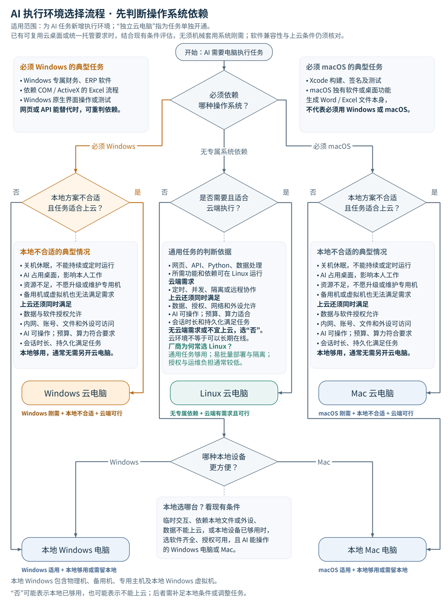

# CloudedPC：AI 云电脑研究与执行环境选型

本仓库汇集 AI 执行环境选型、Dot 与 WorkBuddy 云电脑比较，以及本项目实例的软硬件、网络和权限检查材料。

首页整理日期：**2026 年 11 月 16 日**（新加坡时间）。各报告的数据日期和证据范围以正文为准；文件更新或图件重绘不代表重新实测。

## 最新定稿：执行环境选择流程

**2026 年 11 月 16 日定稿，已通过 Claude CLI 最终复核。** Markdown、PNG 与 Draw.io 内容一致，先判断操作系统依赖，再判断本地或云端条件，最终保留本地 Windows、Linux 云电脑、Windows 云电脑、本地 Mac、Mac 云电脑五种选择。

已有云桌面或统一托管要求的例外说明已补充：**软件兼容性与上云条件仍须核对。**

| 入口 | 用途 |
| --- | --- |
| [在线阅读：选型说明与厂商系统对比](https://github.com/raoliaoyuan/CloudedPC/blob/main/ai-computer-selection/README.md) | 推荐在 GitHub 阅读，图件和材料链接已适配仓库 |
| [正式 Markdown](https://github.com/raoliaoyuan/CloudedPC/blob/main/ai-computer-selection/document/AI%E6%89%A7%E8%A1%8C%E7%8E%AF%E5%A2%83%E9%80%89%E6%8B%A9%E6%B5%81%E7%A8%8B%E8%AF%B4%E6%98%8E%E4%B8%8E%E5%8E%82%E5%95%86%E7%B3%BB%E7%BB%9F%E5%AF%B9%E6%AF%94.md) | 正式说明文档；图件及项目材料使用仓库相对路径，支持 GitHub 阅读 |
| [高清流程图 PNG](https://github.com/raoliaoyuan/CloudedPC/blob/main/ai-computer-selection/ai-computer-selection.png) | 3320 × 4460，可查看或下载 |
| [可编辑 Draw.io 源图](https://github.com/raoliaoyuan/CloudedPC/blob/main/ai-computer-selection/ai-computer-selection.drawio) | 编辑判断节点、场景说明和连线 |
| [Claude CLI 最终复核报告](https://github.com/raoliaoyuan/CloudedPC/blob/main/ai-computer-selection/document/review/Claude-CLI-%E6%9C%80%E7%BB%88%E5%A4%8D%E6%A0%B8%E6%8A%A5%E5%91%8A.md) | 最终结论为“可定稿”；包含核验范围、限制与计数更正 |

展开最新流程图预览

## 报告入口与版本

下表列出各主题当前优先阅读的版本。只有上面的选型文档与流程图对应本轮最终复核；其他报告保留各自的调查日期与结论边界。

| 主题 | 当前阅读入口 | 版本与数据口径 |
| --- | --- | --- |
| AI 执行环境选型与厂商系统对比 | [GitHub 阅读版](https://github.com/raoliaoyuan/CloudedPC/blob/main/ai-computer-selection/README.md) | **2026-11-16 定稿**；资料初次核对为 11-15，评审修订为 11-16 |
| Dot 与 WorkBuddy 对比及 GUI 体验 | [对比分析报告](https://github.com/raoliaoyuan/CloudedPC/blob/main/codex-dot-workbuddy-comparison-2026-11-15/Codex%20Dot%E5%AF%B9%E6%AF%94%20Workbuddy%E4%BA%91PC%E5%AF%B9%E6%AF%94%E5%88%86%E6%9E%90%E6%8A%A5%E5%91%8A%E5%8F%8AGUI%E4%BD%93%E9%AA%8C%E5%88%86%E6%9E%90.md) | **2026-11-15 修订版**；WorkBuddy 数据采样于 11-10，Dot 配置主要来自 11-11 聊天记录，未新增远程实测 |
| WorkBuddy 环境综合检查 | [腾讯云 CVM 上的 Linux 容器综合报告](https://github.com/raoliaoyuan/CloudedPC/blob/main/audit-2026-11-10/%E8%85%BE%E8%AE%AF%E4%BA%91CVM-Linux%E5%AE%B9%E5%99%A8%E5%BC%80%E5%8F%91%E7%8E%AF%E5%A2%83%E7%BB%BC%E5%90%88%E6%A3%80%E6%9F%A5%E6%8A%A5%E5%91%8A.md) | **当前综合版**；实测于 2026-11-10，8 张图于 11-15 重绘补充 |
| Dot 云电脑配置与运行检查 | [Dot 检查报告](https://github.com/raoliaoyuan/CloudedPC/blob/main/dot-audit-2026-11-13/Dot%E4%BA%91%E7%94%B5%E8%84%91%E8%BD%AF%E7%A1%AC%E4%BB%B6%E9%85%8D%E7%BD%AE%E4%B8%8E%E8%BF%90%E8%A1%8C%E6%A3%80%E6%9F%A5%E6%8A%A5%E5%91%8A.md) | **当前图文版**；11-13 编制，依据 11-11 历史记录，8 张图于 11-15 补充；非独立复测 |
| WorkBuddy 网络结构 | [容器网络逻辑图与说明](https://github.com/raoliaoyuan/CloudedPC/blob/main/network-audit-2026-11-10/WorkBuddy%E5%AE%B9%E5%99%A8%E7%BD%91%E7%BB%9C%E9%80%BB%E8%BE%91%E5%9B%BE.md) | **2026-11-10 专项记录**；正文含 Mermaid 图，区分观察与推测 |
| WorkBuddy 账号与 SSH 权限 | [OpenSSH 用户及权限检查结果](https://github.com/raoliaoyuan/CloudedPC/blob/main/security-audit-2026-11-10/OpenSSH%E7%94%A8%E6%88%B7%E5%8F%8A%E6%9D%83%E9%99%90%E6%A3%80%E6%9F%A5%E7%BB%93%E6%9E%9C.md) | **2026-11-10 专项记录**；本项目容器的只读检查 |

历史报告保留用于追溯，阅读时优先使用上表中的对应版本：

- [云 PC 软硬件配置与运行检查报告（2026-11-10 初版）](https://github.com/raoliaoyuan/CloudedPC/blob/main/audit-2026-11-10/%E4%BA%91PC%E8%BD%AF%E7%A1%AC%E4%BB%B6%E6%A3%80%E6%9F%A5%E6%8A%A5%E5%91%8A.md)：后续多轮结果汇总于 WorkBuddy 综合报告。
- [Dot 与云 PC 对比及 GUI 设计分析报告（2026-11-13 版）](https://github.com/raoliaoyuan/CloudedPC/blob/main/dot-comparison-2026-11-13/Dot%E4%B8%8E%E4%BA%91PC%E5%AF%B9%E6%AF%94%E5%8F%8AGUI%E8%AE%BE%E8%AE%A1%E5%88%86%E6%9E%90%E6%8A%A5%E5%91%8A.md)：同主题优先阅读 2026-11-15 修订版。

## 流程图与可编辑图集

| 图件主题 | 查看图件 | 可编辑源文件 |
| --- | --- | --- |
| AI 执行环境选择流程（1 张） | [PNG](https://github.com/raoliaoyuan/CloudedPC/blob/main/ai-computer-selection/ai-computer-selection.png) | [Draw.io](https://github.com/raoliaoyuan/CloudedPC/blob/main/ai-computer-selection/ai-computer-selection.drawio) |
| WorkBuddy 综合报告（8 张） | [正文及分图入口](https://github.com/raoliaoyuan/CloudedPC/blob/main/audit-2026-11-10/%E8%85%BE%E8%AE%AF%E4%BA%91CVM-Linux%E5%AE%B9%E5%99%A8%E5%BC%80%E5%8F%91%E7%8E%AF%E5%A2%83%E7%BB%BC%E5%90%88%E6%A3%80%E6%9F%A5%E6%8A%A5%E5%91%8A.md) · [PNG / SVG / 单图源文件](https://github.com/raoliaoyuan/CloudedPC/tree/main/audit-2026-11-10/assets/report-diagrams) | [完整图集 · 8 页](https://github.com/raoliaoyuan/CloudedPC/blob/main/audit-2026-11-10/assets/report-diagrams/%E5%AE%8C%E6%95%B4%E6%8A%A5%E5%91%8A%E5%9B%BE%E9%9B%86.drawio) |
| Dot 检查报告（8 张） | [图件说明与来源索引](https://github.com/raoliaoyuan/CloudedPC/blob/main/dot-audit-2026-11-13/%E5%9B%BE%E4%BB%B6%E8%AF%B4%E6%98%8E%E4%B8%8E%E6%9D%A5%E6%BA%90%E7%B4%A2%E5%BC%95.md) | [完整图集 · 8 页](https://github.com/raoliaoyuan/CloudedPC/blob/main/dot-audit-2026-11-13/assets/report-diagrams/Dot%E4%BA%91%E7%94%B5%E8%84%91%E5%AE%8C%E6%95%B4%E5%9B%BE%E9%9B%86.drawio) |
| Dot 与 WorkBuddy 对比（6 张） | [图件与文件使用说明](https://github.com/raoliaoyuan/CloudedPC/blob/main/codex-dot-workbuddy-comparison-2026-11-15/%E5%9B%BE%E4%BB%B6%E4%B8%8E%E6%96%87%E4%BB%B6%E4%BD%BF%E7%94%A8%E8%AF%B4%E6%98%8E.md) | [完整图集 · 6 页](https://github.com/raoliaoyuan/CloudedPC/blob/main/codex-dot-workbuddy-comparison-2026-11-15/assets/report-diagrams/CodexDot%E4%B8%8EWorkBuddy%E5%AE%8C%E6%95%B4%E5%9B%BE%E9%9B%86.drawio) |
| WorkBuddy 网络专项图 | [Markdown 内嵌 Mermaid](https://github.com/raoliaoyuan/CloudedPC/blob/main/network-audit-2026-11-10/WorkBuddy%E5%AE%B9%E5%99%A8%E7%BD%91%E7%BB%9C%E9%80%BB%E8%BE%91%E5%9B%BE.md) | Mermaid 源码位于同一文档 |

需要离线阅读或编辑报告图集时，可使用已有交付包并保留解压后的目录结构：[WorkBuddy 综合报告图文包](https://github.com/raoliaoyuan/CloudedPC/blob/main/audit-2026-11-10/%E8%85%BE%E8%AE%AF%E4%BA%91CVM-Linux%E5%AE%B9%E5%99%A8%E5%BC%80%E5%8F%91%E7%8E%AF%E5%A2%83%E7%BB%BC%E5%90%88%E6%A3%80%E6%9F%A5%E6%8A%A5%E5%91%8A-%E5%9B%BE%E6%96%87%E5%8F%8A%E5%8F%AF%E7%BC%96%E8%BE%91%E6%BA%90%E6%96%87%E4%BB%B6.zip)、[Dot 报告图文包](https://github.com/raoliaoyuan/CloudedPC/blob/main/dot-audit-2026-11-13/Dot%E4%BA%91%E7%94%B5%E8%84%91%E8%BD%AF%E7%A1%AC%E4%BB%B6%E9%85%8D%E7%BD%AE%E4%B8%8E%E8%BF%90%E8%A1%8C%E6%A3%80%E6%9F%A5%E6%8A%A5%E5%91%8A-%E5%9B%BE%E6%96%87%E5%8F%8A%E5%8F%AF%E7%BC%96%E8%BE%91%E6%BA%90%E6%96%87%E4%BB%B6.zip)、[对比报告完整交付包](https://github.com/raoliaoyuan/CloudedPC/blob/main/codex-dot-workbuddy-comparison-2026-11-15/Codex%20Dot%E5%AF%B9%E6%AF%94%20Workbuddy%E4%BA%91PC%E5%AF%B9%E6%AF%94%E5%88%86%E6%9E%90%E6%8A%A5%E5%91%8A%E5%8F%8AGUI%E4%BD%93%E9%AA%8C%E5%88%86%E6%9E%90-%E5%AE%8C%E6%95%B4%E4%BA%A4%E4%BB%98%E5%8C%85.zip)。这些包属于各自报告的交付版本，不包含 11-16 的选型定稿文件。

## 评审记录与文件使用

选型文档的评审过程可从 [评审意见处理记录](https://github.com/raoliaoyuan/CloudedPC/blob/main/ai-computer-selection/document/review/%E8%AF%84%E5%AE%A1%E6%84%8F%E8%A7%81%E5%A4%84%E7%90%86%E8%AE%B0%E5%BD%95.md)、[图文一致性复核报告](https://github.com/raoliaoyuan/CloudedPC/blob/main/ai-computer-selection/document/review/Claude-CLI-%E5%9B%BE%E6%96%87%E4%B8%80%E8%87%B4%E6%80%A7%E5%A4%8D%E6%A0%B8%E6%8A%A5%E5%91%8A.md) 和 [最终复核报告](https://github.com/raoliaoyuan/CloudedPC/blob/main/ai-computer-selection/document/review/Claude-CLI-%E6%9C%80%E7%BB%88%E5%A4%8D%E6%A0%B8%E6%8A%A5%E5%91%8A.md) 追溯；原始 CLI 结果、送审文件摘要和修订记录保存在 [review 目录](https://github.com/raoliaoyuan/CloudedPC/tree/main/ai-computer-selection/document/review)。

- **选型定稿文件**：以正式 Markdown、顶层 PNG 和 Draw.io 为准。GitHub 阅读版适配当前目录下的文件链接并补充导航。正式 Markdown 的文件引用已修正为仓库相对路径，判断逻辑与报告结论沿用最终复核版本。
- **历史过程文件**：选型目录中的 Word、PDF、`qa`、`qa-final`、评审前副本和早期转换脚本保留用于追溯，并非 11-16 定稿；不要用早期 Word 转换脚本覆盖正式 Markdown。
- **修改与再生成**：[流程图生成脚本](https://github.com/raoliaoyuan/CloudedPC/blob/main/ai-computer-selection/build_diagram.py) 同时生成 PNG、Draw.io 和预览图；[GitHub 阅读版生成脚本](https://github.com/raoliaoyuan/CloudedPC/blob/main/ai-computer-selection/build_github_readme.py) 从正式 Markdown 更新在线阅读版。修改正式内容后，应重新核对图文一致性。
- **证据范围**：WorkBuddy 结果只代表已检查的项目实例；Dot 的历史助手陈述、用户观察和官方说明分别标注。历史版本与本次复核均不构成对全部产品实例或当前服务状态的保证。
