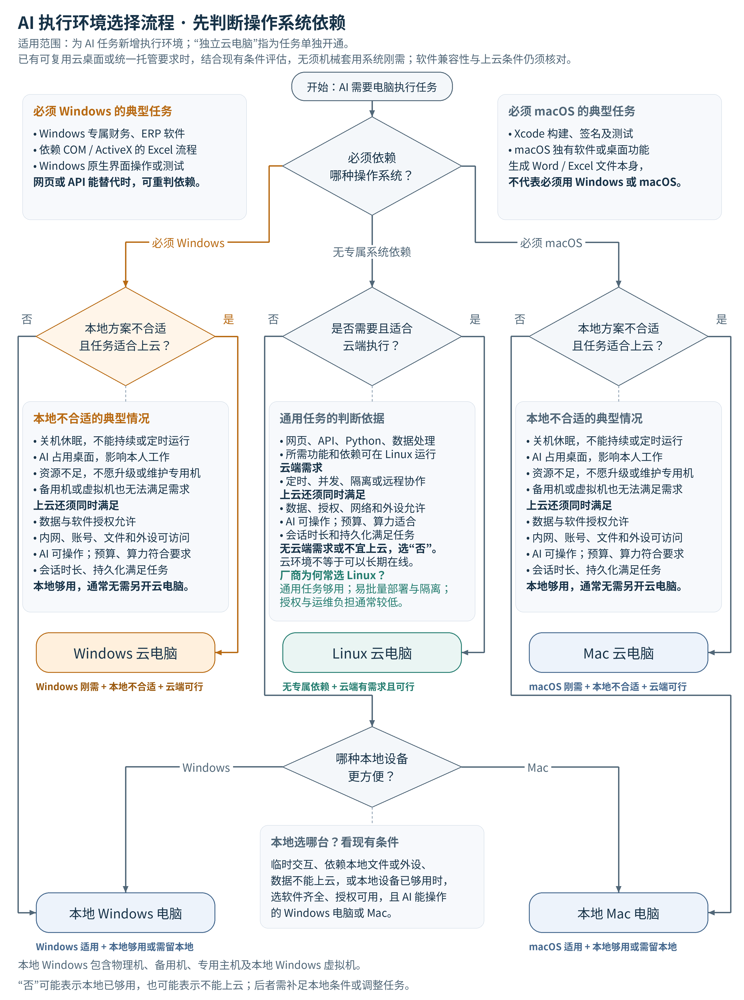

# AI执行环境选择流程说明与厂商系统对比

资料核对日期 2026年11月15日  新加坡时间

本说明配合《AI 执行环境选择流程》使用，帮助读者先识别任务的操作系统依赖，再决定使用本地电脑或云端环境，并理解已研究 AI 产品实际提供的执行系统。

**主要结论：独立 Windows 云电脑通常适用于“必须 Windows、本地方案不合适、上云条件成立”的交集。没有专属系统依赖的任务，可以优先评估 Linux 云环境；能够在现有 Windows 或 Mac 上完成的任务，也可留在本地。**

## 1 先分清电脑和执行环境

“云电脑”在产品介绍中并非统一规格。完整云桌面有图形界面；云端浏览器主要执行网页任务；代码沙箱提供终端、程序和文件处理能力。三者都可能在云端运行，但安装软件、人工接管、会话保留和网络能力不同。Computer Use 模型或 API 则是操作能力，还需要实际的电脑、浏览器或沙箱承接动作。

本文把云端 Linux 桌面、容器和微型虚拟机作为“Linux 云电脑”分支中的不同实现，选型时仍须核对任务真正需要的能力。五个终点是环境类别，并非同一厂商都能提供的五种套餐。

### 五种最终选择

| **选择** | **进入该分支的条件** | **典型任务** |
| --- | --- | --- |
| 本地 Windows 电脑 | Windows 适用；本地够用或必须留在本地 | 操作已安装的专属软件、连接本地外设 |
| Linux 云电脑 | 无专属系统依赖；需要且适合云端执行 | 网页任务、数据分析、代码与文档生成 |
| Windows 云电脑 | Windows 刚需；本地不合适；云端可行 | 独立运行 Windows 客户端自动化 |
| 本地 Mac 电脑 | macOS 适用；本地够用或必须留在本地 | 本地 Apple 开发、Mac 应用及文件处理 |
| Mac 云电脑 | macOS 刚需；本地不合适；云端可行 | 远程 Apple 平台构建与专属软件任务 |

本地 Windows 包含物理机、备用机、专用主机及本地 Windows 虚拟机。若云端不允许而本地暂不够用，应补足本地条件或调整任务，而不是直接认定现有机器能完成。

## 2 选择流程图

从最上方的操作系统判断开始，沿实线箭头选择；虚线只连接场景说明，不代表执行步骤。

[高清 PNG](../../ai-computer-selection.png) · [可编辑 Draw.io 源图](../../ai-computer-selection.drawio)

图 1  当前确认版流程图。保留节点旁的典型场景、Linux 选型原因，以及五个结果节点下方的选择条件。

## 3 如何逐步作出判断

### 第一步 判断是否必须依赖某个系统

判断对象是必需的软件、插件和功能，而非用户平时使用哪台电脑。Windows 刚需包括仅提供 Windows 客户端的财务或 ERP 软件、依赖 Windows COM 或 ActiveX 的流程，以及 Windows 原生界面的操作或测试。macOS 刚需包括使用 Xcode 的构建、签名与测试，以及依赖 Mac 独有软件的任务。

网页、API、常规 Python 和数据处理往往没有专属系统依赖。生成 Word、Excel 或 PPT 文件本身也不构成 Windows 刚需；如果必须保持特定宏、插件、排版或应用行为，则应重新验证兼容性。网页或 API 能完整替代原客户端功能时，可以重新判断系统依赖。

### 第二步 判断本地是否合适

本地不合适通常是无法或不愿满足任务要求：电脑经常关机或休眠，AI 操作鼠标和桌面会干扰本人工作，内存或并发不足，或者不愿维护专用设备。先评估备用机与本地虚拟机；如果它们已经满足要求，就没有必须上云的理由。

对于无系统刚需的任务，定时运行、批量并发、环境隔离或远程协作可能构成云端需求；临时交互、依赖本地文件和外设、数据不宜上传时，则更适合现有本地设备。

### 第三步 判断任务能否上云

上云前应确认数据和软件授权允许，云端能够访问所需账号、内网、文件与外设，AI 工具确实能够控制该环境，并且算力、预算、会话时长与数据持久化符合任务要求。不能把“能保存文件”理解为“后台进程永远在线”，也不能把“有浏览器”理解为“能安装任意桌面软件”。

### Windows 云电脑的三个必要条件

| **条件** | **判断示例** |
| --- | --- |
| 必须 Windows | 业务只提供 Windows 客户端，且没有满足要求的网页或 API 替代 |
| 本地方案不合适 | 需要每天自动运行，但本机经常关闭，备用机或虚拟机也不满足要求 |
| 云端可行 | 软件可在云端授权运行，账号、内网和外设可访问，AI 控制方式已验证 |

三项同时成立时，独立 Windows 云电脑才有明确的选型理由。如果缺少第一项，应重新评估 Linux 云环境；如果本地已满足要求，可保留本地 Windows；如果上云条件不成立，应解决限制，而不是绕过限制选择云端。

## 4 已研究 AI 产品的系统与环境对比

比较的是任务实际执行的位置及系统，不是客户端下载页支持的系统。“官方”表示文档明确说明；“实测”限定于已检查的实例；“历史记录”不等同于本次复测；“未确认”也不表示不存在。

| **厂商与对象** | **提供的环境** | **系统信息** | **证据范围与选型含义** |
| --- | --- | --- | --- |
| OpenAI ChatGPT dots | 自有云电脑与浏览器；也可连接用户电脑 | 历史记录为 Linux／Debian 13.6 trixie；官方页面未明确发行版 | 官方确认云电脑、接管及状态延续。Debian 版本仅来自本项目历史记录，未独立复测；不能外推全部 dots。[O1][L1] |
| OpenAI Codex Cloud | 面向代码任务的云端工作区；当前文档称每任务使用 VM | 本次核对的当前文档未明确发行版 | 与 dot 自有电脑不同。Legacy 文档描述容器，不能把旧架构直接套到当前产品。[O2][O3] |
| Anthropic Claude 代码执行 | 厂商托管的代码执行沙箱 | 官方明确为 Linux 容器 | 属于 Linux 云执行环境，不等同于可登录的完整云桌面。文档还限制外网访问，不能直接承担所有网页任务。[A1] |
| Anthropic Claude Computer Use | 电脑操作 API 与参考实现 | 官方参考实现是 Docker 内的 Linux 桌面 | 应用方执行操作并回传画面；参考实现不等于给每位 Claude 用户分配一台独立云电脑。[A2] |
| Google Gemini Computer Use | 电脑操作 API；开发者提供执行环境 | 取决于接入的目标环境；没有统一云电脑系统结论 | 官方说明客户端执行动作并提供沙箱配置指导；不能仅凭 API 推断 Google 交付 Linux 云桌面。[G1] |
| 腾讯 WorkBuddy 本项目实例 | 托管云端 Linux 容器；桌面客户端另算 | 2026年11月10日实测为 Ubuntu 24.04.3 LTS | 有原始系统采样支持。本实例未验证完整桌面，不代表全部 WorkBuddy 模式或实例都使用该系统。[L2][L3] |
| 百度 搭子 DuMate | 官方支持云端任务或连接本地电脑执行 | 云端操作系统及发行版未确认 | 云端执行已确认；独立完整云桌面的交付形式未确认。客户端支持 Windows、macOS、Linux 不证明云端系统相同。[B1][B2] |

**对比结论：可以确认若干 Linux 实现，但不能把“Claude、ChatGPT、Google、腾讯、百度都提供同一种 Linux 云电脑”写成统一事实。产品模式、执行位置和证据层级必须一起比较。**

## 5 Linux 常见的原因与选型边界

此前讨论的 E2B 和 Vercel 属于 Agent 执行基础设施，适合与上页产品对照理解，但它们不等同于面向普通用户的聊天助手。

| **服务** | **官方确认的系统与形态** | **对流程图的意义** |
| --- | --- | --- |
| E2B | 每个 Agent 会话可使用 Linux 微型虚拟机；Desktop 能力提供屏幕、鼠标、键盘和画面流。[I1] | Linux 既可用于代码执行，也可承接图形界面任务；具体桌面与工具仍需配置。 |
| Vercel Sandbox | 按需创建的 Linux 微型虚拟机；当前官方 FAQ 说明默认 Ubuntu，也可使用自定义 Linux 镜像。[I2] | 适合通过 SDK／CLI 调用的代码与工具环境；不是默认交付给用户的办公桌面。 |

### 为什么无系统刚需时常选 Linux

任务覆盖方面，浏览器、Python、Node.js 和文件处理工具可以完成大量研究、数据分析、开发和文档生成任务。既然这些任务不依赖 Windows 或 macOS，Linux 就能满足其执行需求。

工程方面，容器、镜像和微型虚拟机便于自动准备、批量创建、隔离、回收和复用环境。E2B 与 Vercel 的产品形态说明这种设计已经用于 Agent 基础设施；它不意味着 Linux 天然绝对安全，隔离仍取决于具体实现。[I1][I2]

成本方面，对不需要专属桌面应用的任务，Linux 通常可以减少桌面授权、会话和应用维护负担。总成本仍受算力、存储、服务支持和平台收费影响，不能理解为零成本。这是工程与产品分析，不是所有厂商公开披露的决策原因。

### 如何把产品对比用于实际选择

先用流程图确定环境类别，再核对候选产品是否提供相应能力。若任务必须运行 Windows 专属软件，仅提供 Linux 沙箱的 AI 产品并不能直接满足；可评估授权 AI 操作本地 Windows，或另选 Windows 云电脑并验证控制方式。Mac 专属任务同理。

上述产品是否直接提供 Windows 或 macOS 云端选项，应按具体产品确认；本表不能证明全市场没有这类服务。云电脑可用性与 AI 控制能力须分别验收。用真实任务检查软件、账号、网络、运行时长和文件恢复；套餐、地区与开通资格另按当前产品页面核对。

## 6 来源与核对范围

官方网页核对日期为 2026年11月15日；访问日期不是发布日期。下列链接支持各自产品或实现范围，不代表对所有账号、套餐和实例作出统一承诺。

[O1] [OpenAI  Connect computers and apps to your dot](<https://learn.chatgpt.com/docs/dots/computers-and-apps>)  
确认自有云电脑、人工接管、状态延续和连接本地电脑；未明确发行版。

[O2] [OpenAI  Cloud environments](<https://learn.chatgpt.com/docs/environments/cloud-environments>)  
确认当前 Codex Cloud 的云端任务、独立工作区及 VM 说明。

[O3] [OpenAI  Codex Cloud Legacy](<https://learn.chatgpt.com/docs/environments/cloud-environment>)  
用于区分旧容器环境与当前产品，不外推当前系统版本。

[A1] [Anthropic  Code execution tool](<https://platform.claude.com/docs/en/agents-and-tools/tool-use/code-execution-tool>)  
Containers／Runtime environment：Linux 容器；Networking and security：网络限制。

[A2] [Anthropic  Computer use tool](<https://platform.claude.com/docs/en/agents-and-tools/tool-use/computer-use-tool>)  
The computing environment：Linux 桌面参考实现及应用方执行动作。

[G1] [Google  Computer use](<https://ai.google.dev/gemini-api/docs/computer-use>)  
执行动作、准备沙箱及目标环境的接入说明。

[B1] [百度搭子  发起任务](<https://aca.bce.baidu.com/doc/Dumate/s/Lmvhsqzkg>)  
选择执行环境：云端执行与已连接设备执行。

[B2] [百度搭子官网](<https://www.dumate.cn/>)  
客户端下载平台与本地运行产品说明；不能当作云端系统清单。

[I1] [E2B  The agent cloud](<https://e2b.dev/>)  
Sandbox 与 Desktop：Linux 微型虚拟机及屏幕交互能力。

[I2] [Vercel  Sandbox](<https://vercel.com/sandbox>)  
FAQ：Linux microVM、默认 Ubuntu 以及可替换的 Linux 镜像。

### 项目内既有研究材料

[L1] Dot云电脑软硬件配置与运行检查报告  
2026年11月13日整理，主要依据11月11日聊天记录；Debian 13.6 为历史记录，本次未复测。[  查看项目原始材料](../../../dot-audit-2026-11-13/Dot%E4%BA%91%E7%94%B5%E8%84%91%E8%BD%AF%E7%A1%AC%E4%BB%B6%E9%85%8D%E7%BD%AE%E4%B8%8E%E8%BF%90%E8%A1%8C%E6%A3%80%E6%9F%A5%E6%8A%A5%E5%91%8A.md)

[L2] 腾讯云CVM Linux容器开发环境综合检查报告  
2026年11月10日实测；第2章给出 Ubuntu 24.04.3 LTS，检查对象为本项目 WorkBuddy 容器。[  查看项目原始材料](../../../audit-2026-11-10/%E8%85%BE%E8%AE%AF%E4%BA%91CVM-Linux%E5%AE%B9%E5%99%A8%E5%BC%80%E5%8F%91%E7%8E%AF%E5%A2%83%E7%BB%BC%E5%90%88%E6%A3%80%E6%9F%A5%E6%8A%A5%E5%91%8A.md)

[L3] WorkBuddy 原始采样 evidence.txt  
文件开头的 /etc/os-release 采样支持 Ubuntu 24.04.3 LTS。[  查看项目原始材料](../../../audit-2026-11-10/evidence.txt)

流程图配套文件位于 ai-computer-selection 目录，文件名为 ai-computer-selection.png 与 ai-computer-selection.drawio。本文嵌入的图为本次说明文档所对应的确认版本。
