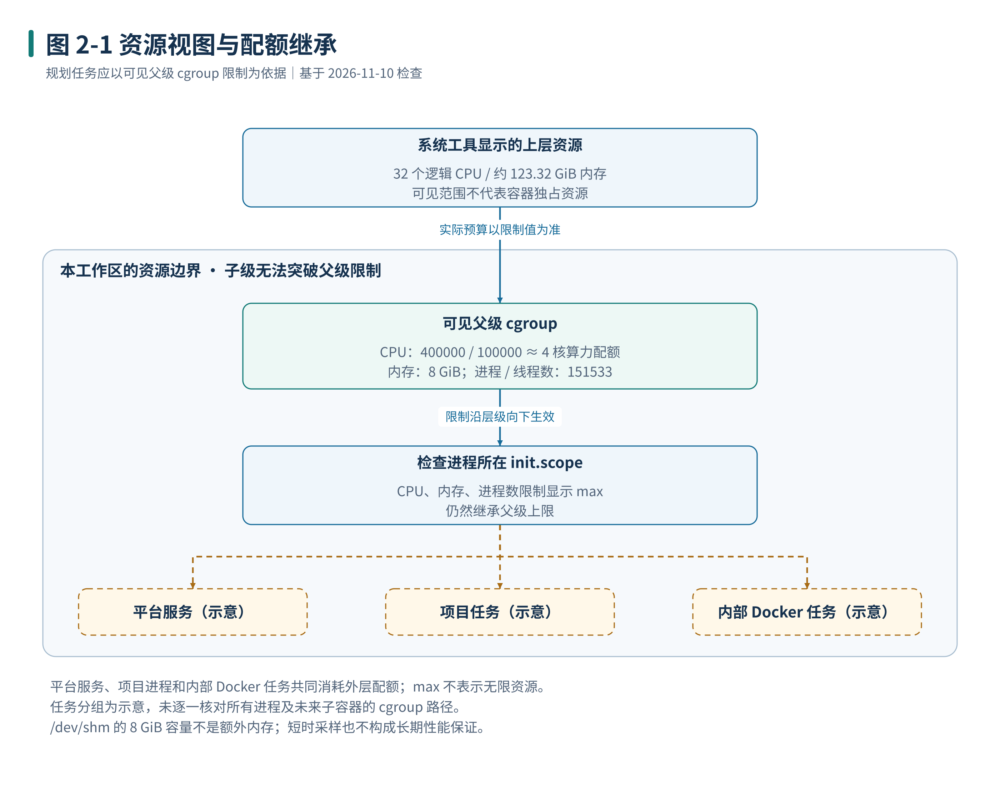
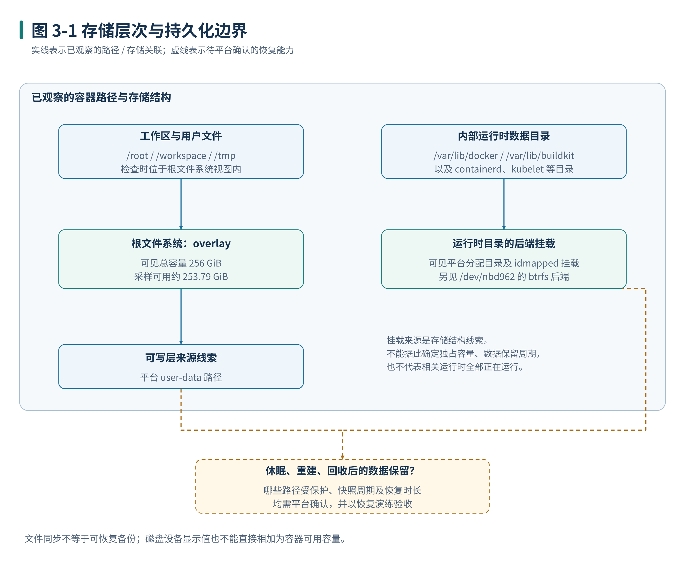
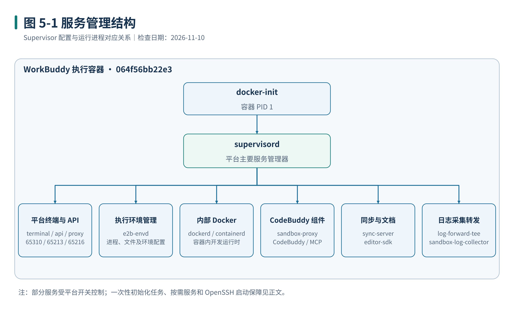
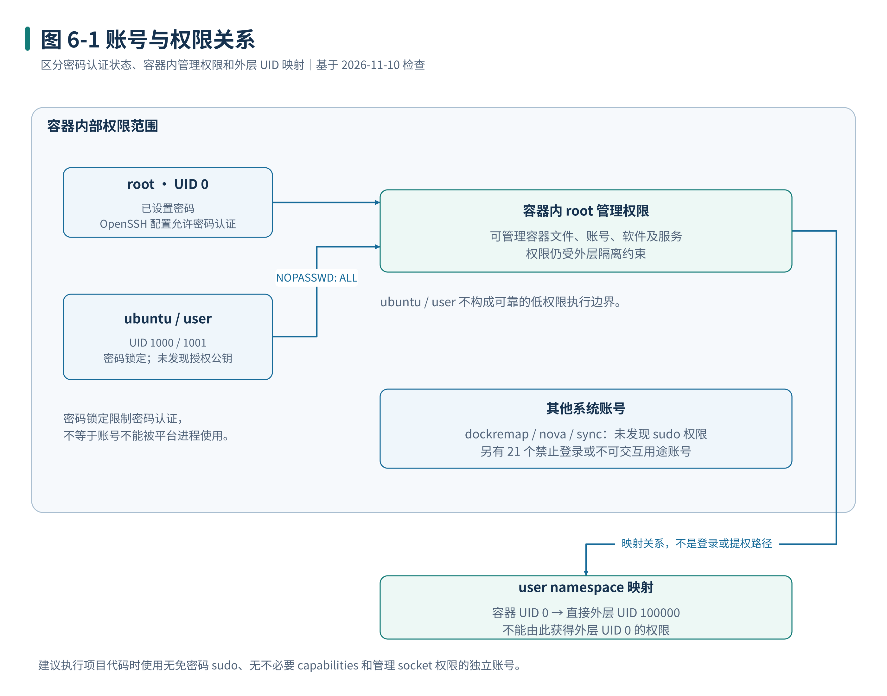
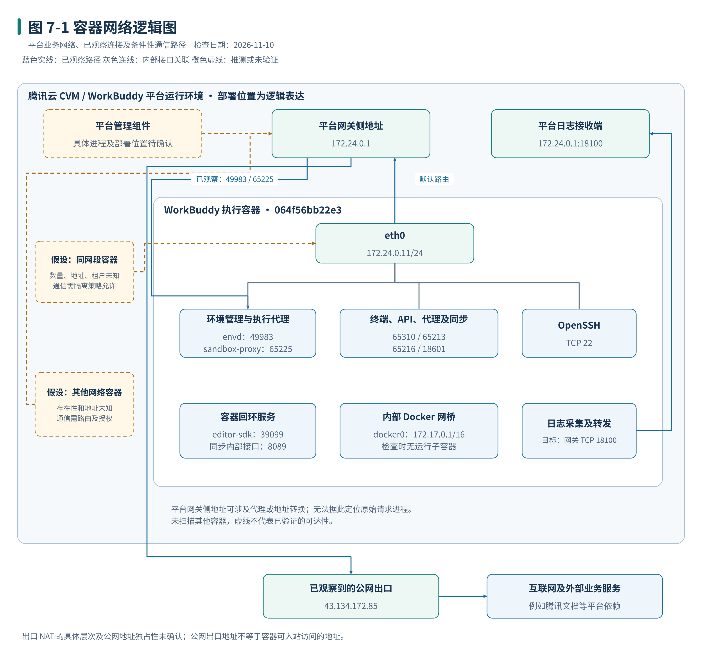
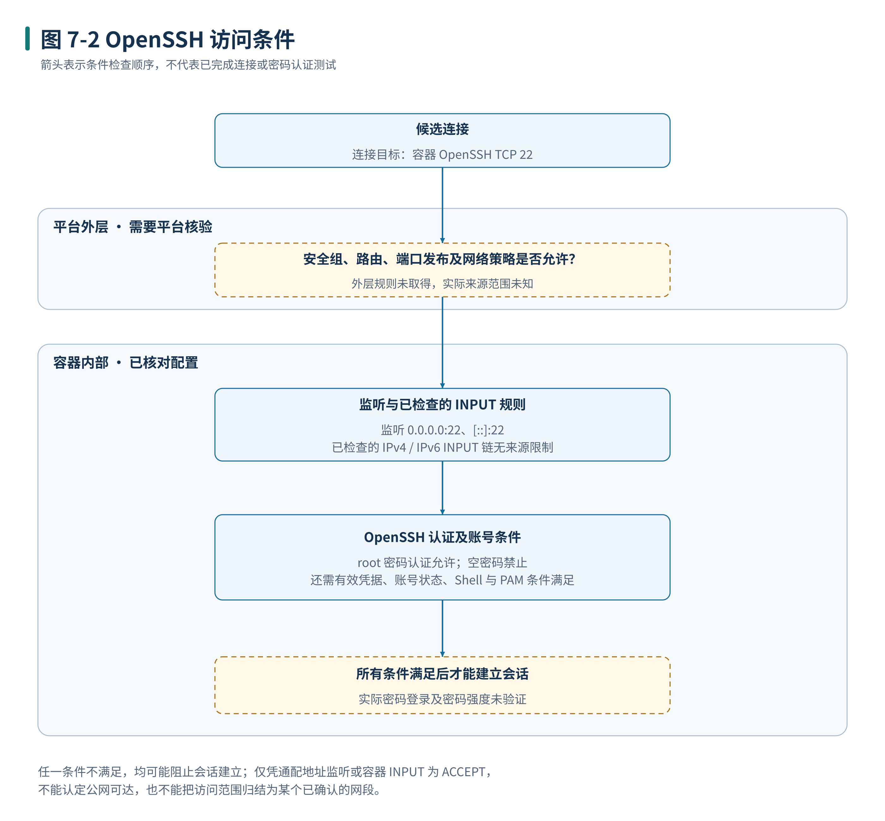
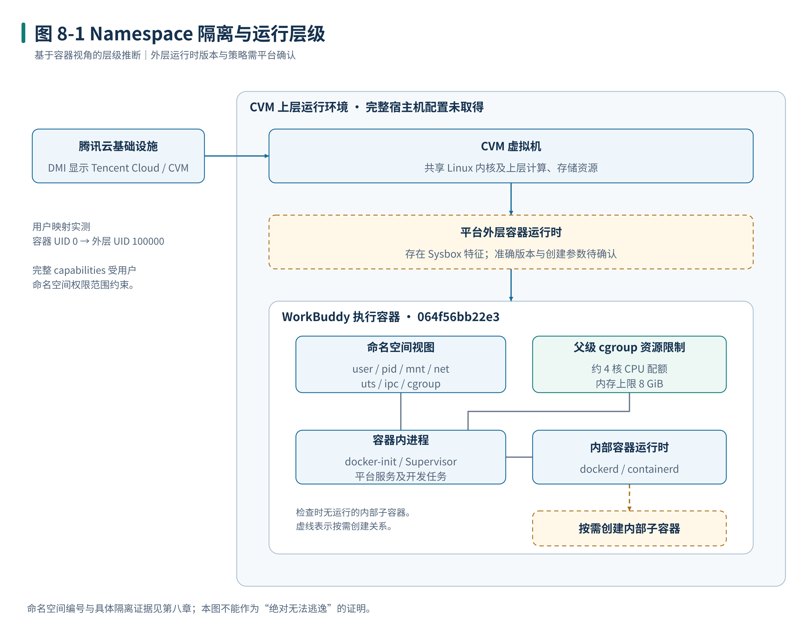
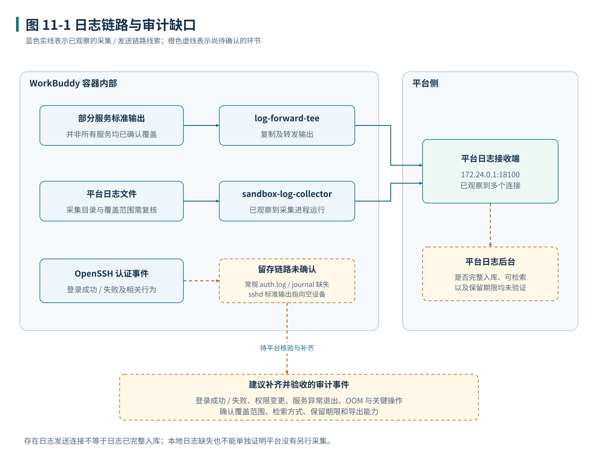

# 腾讯云 CVM 虚拟机上的 Linux 容器开发环境综合检查报告

**检查对象：** WorkBuddy 托管 Linux 执行容器  
**容器主机名：** `064f56bb22e3`  
**检查日期：** 2026 年 11 月 10 日  
**资料范围：** 当日多轮软硬件、服务、网络、账号及安全检查；namespace 信息补充核验至 17:52，新加坡时间（UTC+8）  
**管理权限范围：** 容器内部管理员权限；不包含平台宿主机管理权限

**图件附件：** [完整可编辑图集（draw.io，8 页）](assets/report-diagrams/完整报告图集.drawio)。正文使用 PNG 直接展示，每图另附 SVG 与独立 draw.io 源文件。图件按章节编号，于 2026 年 11 月 15 日重新绘制并补充；检查数据日期保持不变。

---

## 第一章　总体结论与检查范围

### 1.1 总体结论

当前环境是一套运行于腾讯云 CVM 上的、具有 **Sysbox 系统容器特征**的 WorkBuddy 开发与任务执行环境。

按照可见的 cgroup 限制，应以 **约 4 核 CPU 算力配额、8 GiB 内存上限、256 GiB 根文件系统容量视图**规划任务。系统显示的 32 个逻辑 CPU、约 123.32 GiB 内存属于上层资源视图，不能全部视为本容器可独占使用的资源。

| 领域 | 综合判断 |
|---|---|
| 基础运行 | 检查时核心平台进程运行，未观察到明显资源压力 |
| 开发能力 | 已具备 Python、Node.js、Git、编译工具及内部 Docker 环境 |
| 硬件加速 | 未发现已分配 GPU、图形加速设备或 KVM 设备 |
| 服务管理 | 使用 `docker-init` 与 Supervisor，不能按完整 systemd 虚拟机管理 |
| 软件维护 | 存在更新积压、旧运行时及多版本工具链混用问题 |
| 用户权限 | root 权限较大；ubuntu、user 均可免密码提升为容器 root |
| 网络防护 | 多个平台服务监听通配地址；容器内检查到的 INPUT 链没有来源限制 |
| 隔离机制 | 已观察到用户映射、命名空间、seccomp、设备屏蔽和资源限制 |
| 逃逸核验 | 未证实能够逃逸；不能保证所有已知或未知逃逸路径均已阻断 |
| 运维保障 | 平台侧补丁、跨租户隔离、备份恢复和日志留存仍需确认 |

该环境适合日常编程、脚本自动化、轻量容器、小型 Web/API 和文档处理。大型并行编译、多浏览器并发、重型数据分析等任务需要额外控制内存和并发。

### 1.2 检查方法与证据分类

报告采用以下分类：

- **实测结果：** 来自系统文件、配置、进程、监听端口、现有连接及有限的只读验证。
- **合理推断：** 多项证据支持，但未从宿主机侧直接确认。
- **待确认事项：** 需要平台管理权限、后台记录或专门测试才能回答。

调查主要进行了配置读取、资源短时采样、软件版本检查、进程与命名空间核对、设备及挂载检查，以及有限的访问权限验证。

未执行软件升级、配置整改、服务重启、磁盘写入压测、全负载压力测试、跨租户扫描或容器逃逸漏洞利用。本文的整改建议尚未实施。

---

## 第二章　硬件信息与实际资源配额

### 2.1 上层虚拟化环境

| 项目 | 检查结果 | 解释 |
|---|---|---|
| DMI 厂商 | `Tencent Cloud` | 支持环境位于腾讯云基础设施上的判断 |
| DMI 产品 | `CVM` | 上层为云虚拟机 |
| CPU 虚拟化标识 | KVM | 表明存在虚拟化层 |
| 容器检测 | `docker` | 当前工作环境属于容器 |
| CPU 型号字符串 | AMD EPYC 9754 128-Core Processor | 不代表本容器获配 128 核 |
| 可见 CPU 拓扑 | 32 个逻辑 CPU，16 核 × 2 线程 | 属于可见的上层拓扑 |
| 可见内存总量 | 约 123.32 GiB | 不等于容器可使用内存上限 |

未取得 CVM 实例 ID、实例套餐、所在可用区、宿主机完整操作系统信息或物理服务器健康信息。

### 2.2 本容器实际资源边界

| 项目 | 实测值 | 实际含义 |
|---|---|---|
| CPU 配额 | `cpu.max = 400000 100000` | 每 100 ms 周期最多累计使用 400 ms CPU 时间，约等于 4 核算力上限 |
| CPU 可调度范围 | `0–31` | 调度范围大于配额，不代表可以持续使用全部 32 核 |
| 内存硬限制 | `8589934592` 字节 | 8 GiB |
| 进程数限制 | `pids.max = 151533` | 可见父 cgroup 的进程/线程数量限制 |
| 实际交换空间 | 未发现可用交换空间，采样使用量为 0 | 不能依赖 swap 承接内存峰值 |
| 共享内存文件系统 | `/dev/shm` 显示 8 GiB | 使用时仍消耗内存资源，不是额外赠送的内存 |

进程所在的 `init.scope` 中，CPU、内存和进程数限制显示为 `max`，但其父级存在上述限制。子 cgroup 仍受父级约束，因此不能仅依据叶子节点或 `Docker info` 判断资源上限。[Linux cgroup v2 文档](https://www.kernel.org/doc/html/latest/admin-guide/cgroup-v2.html)

<!-- diagram:04-resource-inheritance -->

下图说明上层资源视图、父级配额与子任务之间的关系。平台服务和项目任务共同消耗外层预算；任务分组为示意，不表示所有进程或未来子容器均属于同一个子 cgroup。



[SVG 矢量图](assets/report-diagrams/04-resource-inheritance.svg) · [可编辑 draw.io 源文件](assets/report-diagrams/04-resource-inheritance.drawio)

<!-- /diagram:04-resource-inheritance -->

### 2.3 检查时的资源健康状态

以下为当日采样结果，非持续监控数据：

| 指标 | 检查结果 |
|---|---|
| 内存使用 | 约 1.48 GiB，占 8 GiB 上限约 18.5% |
| 内存历史峰值 | 约 1.55 GiB，仅覆盖当前 cgroup 生命周期 |
| 内存事件 | 未记录 `max`、`oom`、`oom_kill` 事件 |
| CPU 五秒采样 | 平均约使用 0.03185 核，约占 4 核配额的 0.80% |
| CPU 节流 | 累计 5 次，采样期间没有新增 |
| CPU 累计节流时间 | 约 1.06 秒 |
| PSI 压力 | 当时 CPU、内存、I/O 的相关平均压力指标为 0 |
| 网卡错误计数 | eth0 收发错误及丢弃计数为 0 |
| 软件包状态 | `dpkg --audit` 未报告未完成配置问题 |

这些结果支持“检查时运行较空闲、未见明显资源瓶颈”的结论，不能证明高负载性能、长期稳定性或物理硬件完全无故障。

### 2.4 GPU 与嵌套虚拟化

未发现以下设备：

```text
/dev/nvidia*
/dev/dri
/dev/kvm
```

`nvidia-smi` 不可用。系统安装过 NVIDIA 容器组件或存在相关安装记录，不能证明实际分配了 GPU。

当前未验证以下能力：

- CUDA 计算；
- GPU 图形渲染；
- 硬件视频编码与解码；
- 基于 KVM 的嵌套虚拟机。

---

## 第三章　存储结构与数据持久化

### 3.1 容量与文件系统

| 项目 | 检查结果 |
|---|---|
| 根文件系统 | overlay |
| 根目录可见总容量 | 256 GiB |
| 采样可用容量 | 约 253.79 GiB |
| 常用路径 | `/root`、`/workspace`、`/tmp` 位于根文件系统视图内 |
| 存储后端线索 | 平台 user-data 路径、btrfs、`/dev/nbd962` |
| 内部 Docker 数据 | `/var/lib/docker`，另有平台分配的存储挂载 |
| 其他运行时目录 | `/var/lib/buildkit`、containerd、kubelet、k0s、k3s、rke2 等目录 |

挂载表显示部分运行时目录具有平台提供的独立目录或后端挂载。这些目录存在，不代表对应 Kubernetes 等服务正在运行。

### 3.2 上层磁盘信息的解释

块设备信息中曾显示：

- `vda`：约 1000 GiB；
- `vdb`：约 2 TiB；
- `vdc`：约 100 GiB。

这些属于上层可见信息，不能直接相加为本容器可使用容量。后续 `/dev` 检查未发现可直接访问这些磁盘的对应设备节点。

同样，虚拟磁盘显示 `ROTA=1`，不足以证明物理介质为机械硬盘。

### 3.3 数据保留能力尚未验证

目前的挂载结构支持“存在平台管理的数据存储”的判断，但未确认：

- 工作区休眠后哪些目录保留；
- 容器重建后哪些目录恢复；
- 镜像升级是否覆盖用户安装的软件；
- 到期回收后的数据保留时间；
- 内部 Docker 数据是否纳入快照；
- 备份频率、恢复点和恢复时长。

未执行 SMART、fsck、fio 或写入压力测试，因此不能评价底层磁盘寿命、坏块、真实 IOPS 和持续吞吐量。

**建议：**由平台明确 `/workspace`、`/root`、运行时数据目录和会话记录的保留规则，并完成一次小文件恢复演练。

<!-- diagram:05-storage-persistence -->

下图将可观察的存储结构与尚未验证的数据保留能力分开。虚线表示需要平台确认的持久化和恢复保障，不表示已建立备份。



[SVG 矢量图](assets/report-diagrams/05-storage-persistence.svg) · [可编辑 draw.io 源文件](assets/report-diagrams/05-storage-persistence.drawio)

<!-- /diagram:05-storage-persistence -->

---

## 第四章　操作系统与软件环境

### 4.1 操作系统基础信息

| 项目 | 实测结果 |
|---|---|
| 用户态发行版 | Ubuntu 24.04.3 LTS |
| 架构 | x86_64 |
| 内核 | `6.6.117-45.14.1.tl4.x86_64` |
| 容器主机名 | `064f56bb22e3` |
| PID 1 | `docker-init` |
| 主要服务管理器 | Supervisor |
| 已安装 APT 包 | 初次统计为 871 个 |

Ubuntu 用户态版本不意味着使用 Ubuntu 标准发行版内核。共享内核及相关补丁主要由平台维护。

### 4.2 开发工具与运行时

| 软件 | 已检查版本或状态 | 备注 |
|---|---|---|
| 系统 Python | 3.12.3 | 系统默认解释器 |
| pip | 24.0 | 系统 Python 工具链 |
| pyenv | 2.3.9 开发标识 | 文件存在，默认 PATH 配置有问题 |
| pyenv Python | 3.11.1 | 通过绝对路径可运行 |
| 系统 Node.js | 18.19.1 | 默认命令环境可能优先选中 |
| NVM Node.js | 22.13.1 | 与系统 Node 并存 |
| NVM npm | 11.9.0 | 默认 PATH 下不一定可找到 |
| pnpm | 10.28.2 | 来自全局包信息 |
| TypeScript | 5.9.3 | 来自全局包信息 |
| Angular CLI | 21.1.3 | 与 Node 18 混用会触发问题 |
| Vue CLI | 5.0.9 | 已安装 |
| Playwright | 1.58.1 | 未执行浏览器端到端测试 |
| Git | 2.43.0 | 已安装 |
| OpenSSH | 9.6p1，Ubuntu 包修订 `3ubuntu13.20` | 已启动 sshd |
| Docker Engine | 27.5.1 | 容器内部 Docker |
| containerd | 1.7.25 | 内部 Docker 使用 |
| runc | 1.2.4 | 存在需要核实的安全更新事项 |
| PM2 | 6.0.14 | 存在兼容用途的进程管理条目 |
| gcc、g++、cmake、make | 可找到 | 未执行完整编译验证 |

系统 Python 包中还发现 NumPy 1.26.4、Pillow 10.2.0、requests 2.31.0 等。

该清单覆盖已检查的系统软件和全局工具，不代表所有项目虚拟环境、插件依赖或项目依赖均已审计。

### 4.3 图形桌面状态

虽然软件包中存在桌面、noVNC、Xvfb 等相关组件，但检查时未发现 Xorg、Xvfb、VNC、RDP、GNOME 或 XFCE 会话进程。

因此，当前确认的是开发平台与命令行任务环境，完整图形桌面能力尚未验证。

---

## 第五章　默认启动服务与职责

### 5.1 服务管理结构

可观察到的主要管理关系为：



[SVG 矢量图](assets/report-diagrams/01-service-structure.svg) · [可编辑 draw.io 源文件](assets/report-diagrams/01-service-structure.drawio)

服务判断综合使用了 Supervisor 配置、进程和监听端口。未获得完整可靠的 Supervisor 实时状态输出，因此“配置自动启动”和“本次实际运行”分别核对。

### 5.2 配置为自动启动、自动重启的主要服务

| 服务 | 检查时状态 | 端口或接口 | 主要作用 |
|---|---|---|---|
| `terminal` | 运行 | TCP 65310 | 平台提供的容器终端服务 |
| `api` | 运行 | TCP 65213 | 平台控制 API，可参与按需启动编辑器 |
| `proxy` | 运行 | TCP 65216 | 本地代理与请求转发，具体路由规则未完整审计 |
| `docker` | 运行 | Unix socket | 提供容器内部 Docker 开发能力 |
| `e2b-envd` | 运行 | TCP 49983 | 执行环境、进程、文件及环境配置管理 |
| `cbc-d` / `sandbox-proxy` | 运行 | TCP 65225、9090 | 对接 CodeBuddy 执行能力和平台请求 |
| `sync-server` | 运行 | TCP 18601、回环 8089 | 文件同步、会话记录同步及相关内部接口 |
| `editor-sdk` | 运行 | 回环 TCP 39099 | 文档本地预览与编辑引擎 |
| `sandbox-log-collector` | 运行 | 连接网关 TCP 18100 | 采集日志并转发至平台接收端 |

上述九项配置均包含 `autostart=true`、`autorestart=true`。部分服务仍受平台功能开关控制，配置自动启动不代表所有工作区一定启用相同功能。

### 5.3 启动阶段执行的一次性任务

| 任务 | 配置性质 | 作用 |
|---|---|---|
| `init-workspace` | 自动启动，不自动重启 | 初始化工作目录、平台配置、DNS、证书及运行元数据等 |
| `git-credential-helper` | 自动启动，不自动重启 | 按平台条件配置 Git 凭据助手 |
| `agent-init` | 自动启动，不自动重启 | 调用平台 agent 初始化相关逻辑 |
| `codebuddy-touch-sessions` | 自动启动，不自动重启 | 更新指定会话 JSONL 文件的时间戳 |

这类任务正常完成后不常驻，不能因没有对应运行进程就判定故障。

`codebuddy-touch-sessions` 会修改会话文件时间戳，因此不能仅根据文件修改时间判断用户实际对话发生时间。

### 5.4 按需启动及子进程

| 组件 | 发现 |
|---|---|
| VS Code 服务 | `autostart=false`、`autorestart=true`；可由平台 API 按需启动，检查时未运行 |
| CodeBuddy 预热进程 | 观察到三个 Node 进程，其中一个有回环端口 62667 |
| `mcp-stdio` | sandbox-proxy 的相关子进程 |
| `sheetagent-mcp` | 电子表格插件组件，元数据显示支持自然语言创建、查询和编辑 xlsx |
| PM2 中的 `sandbox-proxy` 条目 | 实际运行 `/tmp/sandbox-mock.js`，是兼容旧脚本的占位进程 |
| `log-forward-tee`、`nc`、`tail` | 日志复制、转发及跟踪辅助进程 |

PM2 中名称为 `sandbox-proxy` 的占位条目，不能与实际运行的平台 `sandbox-proxy` 服务混为一谈。

### 5.5 OpenSSH 的启动保障

OpenSSH 正在运行，但所检查的 Supervisor 配置中未发现其管理条目。

因此，目前只确认 sshd 已启动，尚未确认：

- 退出后是否自动恢复；
- 工作区重启后是否重新启动；
- 平台休眠或重建后的启动行为。

该环境不是 systemd 主导的系统，不能简单通过 `systemctl enable` 推定服务持久化已经完成。

---

## 第六章　用户、组与权限

### 6.1 本地账号概况

检查到 27 个本地账号。OpenSSH 使用 Linux 系统账号，没有独立的用户数据库。

主要账号如下：

| 用户 | UID | 主目录 | Shell | 密码状态 | 权限说明 |
|---|---:|---|---|---|---|
| root | 0 | `/root` | `/bin/bash` | 已设置密码 | 容器内管理员 |
| ubuntu | 1000 | `/home/ubuntu` | `/bin/bash` | 锁定 | 可免密码 sudo 为 root |
| user | 1001 | `/home/user` | `/bin/sh` | 锁定 | 可免密码 sudo 为 root |
| dockremap | 996 | `/home/dockremap` | `/bin/sh` | 锁定 | 无已发现的 sudo 权限 |
| nova | 101 | `/var/lib/nova` | `/bin/bash` | 锁定 | 无已发现的 sudo 权限 |
| sync | 4 | `/bin` | `/bin/sync` | 锁定 | 特殊系统账号，不提供普通交互 Shell |

“密码锁定”仅说明密码认证受限，不等于账号不能由平台进程使用。

### 6.2 组成员与 sudo

| 用户 | 主要组成员 |
|---|---|
| root | root、users |
| ubuntu | ubuntu、adm、dialout、cdrom、floppy、sudo、audio、dip、video、plugdev |
| user | user、sudo、users |
| dockremap | dockremap |
| nova | nova |
| sync | nogroup |

发现以下 sudo 规则：

```sudoers
root ALL=(ALL:ALL) ALL
%sudo ALL=NOPASSWD:ALL
```

有效权限检查确认，ubuntu 和 user 均可：

```text
(root) NOPASSWD: ALL
```

因此，**把程序从 root 切换为 ubuntu 或 user，不能形成可靠的低权限执行边界**。运行不可信代码需要专门的、无免密码 sudo 和无管理 socket 权限的账号。

<!-- diagram:06-account-privileges -->

下图区分账号认证状态、容器内权限和用户命名空间映射。免密码 sudo 会使普通账号具备获取容器 root 权限的途径，但不意味着获得外层宿主机 root 权限。



[SVG 矢量图](assets/report-diagrams/06-account-privileges.svg) · [可编辑 draw.io 源文件](assets/report-diagrams/06-account-privileges.drawio)

<!-- /diagram:06-account-privileges -->

### 6.3 其他系统账号

其余 21 个账号配置为禁止登录或不可交互用途：

```text
daemon、bin、sys、games、man、lp、mail、news、uucp、
proxy、www-data、backup、list、irc、_apt、nobody、
systemd-network、messagebus、polkitd、pulse、sshd
```

该结果基于本地账号文件，不代表已经审计平台云端身份体系。

### 6.4 root 密码存储情况

| 项目 | 检查结果 |
|---|---|
| 存储文件 | `/etc/shadow` |
| root 密码状态 | `P`，表示已设置密码 |
| 哈希算法标识 | `$y$`，对应 yescrypt |
| 文件权限 | `0640` |
| 文件所有者 | root |
| 密码最后修改日期 | 状态显示为 2026 年 11 月 10 日 |
| 原密码明文 | 未找到 |
| 密码强度 | 未验证 |

报告不收录完整密码哈希。密码哈希是单向验证数据，不能直接解密还原原密码。本次未执行密码猜测或强度测试，也未修改密码。

---

## 第七章　网络信息与网络逻辑图

### 7.1 平台业务网络地址

| 地址或接口 | 角色 | 说明 |
|---|---|---|
| `eth0：172.24.0.11/24` | 容器业务网卡 | 属于平台内部网络 |
| `172.24.0.1` | 默认网关 | 同时观察到平台管理及日志相关连接 |
| `docker0：172.17.0.1/16` | 内部 Docker 网桥 | 检查时没有运行的子容器，网桥无活动连接 |
| `127.0.0.1`、`::1` | 回环地址 | 当前网络命名空间内通信 |
| `43.134.172.85` | 已观察到的公网出口 IPv4 | 未确认独占性、绑定位置或入站可达性 |
| `183.60.83.19`、`183.60.82.98` | DNS 服务器 | 来自容器 DNS 配置 |

eth0 的 MTU 为 1500，观察到的 veth 对端接口索引为 12758。该索引不能直接确定宿主机网桥名称。

公网出口地址未配置在容器网卡上，可能属于上层 CVM 或共享出口设施。没有证据表明它可以直接用于访问容器服务，也未验证可用公网 IPv6。

### 7.2 业务服务监听端口

| TCP 端口 | 绑定范围 | 服务用途 |
|---:|---|---|
| 22 | IPv4、IPv6 通配地址 | OpenSSH |
| 65310 | IPv4 通配地址 | 平台终端 |
| 65213 | 通配地址 | 平台 API |
| 65216 | 通配地址 | 本地代理 |
| 65225 | 通配地址 | sandbox-proxy |
| 49983 | 通配地址 | envd |
| 9090 | 通配地址 | sandbox-proxy 的另一接口 |
| 18601 | 通配地址 | sync-server |
| 8089 | IPv4 回环 | sync-server 内部接口 |
| 39099 | IPv4 回环 | editor-sdk |
| 62667 | IPv4 回环 | CodeBuddy 内部接口，端口可能变化 |

通配地址监听表示服务接受对应本地接口上的连接，**不能单独证明服务对公网开放**。是否可达还取决于宿主机转发、平台代理、安全组及网络策略。

### 7.3 网络逻辑图

实线表示已观察到的接口、路由或连接关系；虚线表示推断或尚未验证的通信路径。图中的平台设施部署位置为逻辑表达，不代表已确认物理部署。



[SVG 矢量图](assets/report-diagrams/02-network-topology.svg) · [可编辑 draw.io 源文件](assets/report-diagrams/02-network-topology.drawio)

### 7.4 与其他容器的关系

存在直接证据的关系包括：

- `172.24.0.1` 与容器的 49983、65225 端口建立连接；
- 容器向 `172.24.0.1:18100` 建立日志转发连接。

这些证据支持平台网关侧组件参与管理与日志收集的判断。但源地址可能经过代理或地址转换，不能由此确定请求最初来自哪个进程或容器。

对其他容器只能作条件性判断：

- 同一虚拟网络中的容器可能存在通信路径，但平台可通过网络策略阻断；
- 不同网络的容器通常需要额外路由、转发或端口发布；
- 当前邻居表只观察到网关，不代表没有其他容器；
- 内部 `docker ps` 为空，不代表 CVM 宿主机没有其他容器。

Docker 网桥的通用行为可用于解释潜在路径，但不能替代对本平台实际网络策略的核验。[Docker 网桥文档](https://docs.docker.com/engine/network/drivers/bridge/)

### 7.5 OpenSSH 22 端口的开放范围

已确认：

```text
0.0.0.0:22
[::]:22
```

所检查的 IPv4、IPv6 iptables INPUT 链，包括 legacy 后端，均为 ACCEPT 且未配置来源限制。未取得完整的原生 nftables 规则集，环境中未找到 `nft` 命令。

因此，目前不能把 22 端口描述为“仅向某个网段开放”。更准确的结论是：

> OpenSSH 在容器内监听所有相应接口，已检查的容器 INPUT 规则未限制来源；实际可访问来源仍由平台外层网络控制决定。

<!-- diagram:07-ssh-access-conditions -->

下图按逻辑顺序整理建立 OpenSSH 会话所需的条件。它描述配置和依赖关系，不表示已完成公网连通性或实际密码认证测试。



[SVG 矢量图](assets/report-diagrams/07-ssh-access-conditions.svg) · [可编辑 draw.io 源文件](assets/report-diagrams/07-ssh-access-conditions.drawio)

<!-- /diagram:07-ssh-access-conditions -->

---

## 第八章　Namespace 隔离与运行层级

### 8.1 推测的整体层级



[SVG 矢量图](assets/report-diagrams/03-namespace-layers.svg) · [可编辑 draw.io 源文件](assets/report-diagrams/03-namespace-layers.drawio)

Sysbox 判断主要来自：

- 多处 `sysboxfs` 挂载；
- 用户 ID 映射；
- `/proc`、`/sys` 部分路径的虚拟化；
- idmapped 挂载；
- 容器内运行 Docker 的结构。

尚未从宿主机取得外层运行时的启动参数，因此不对具体 Sysbox 版本、发行版或商业版本作判断。

### 8.2 已观察到的 namespace 标识

17:52 的补充核验中，当前检查进程与容器 PID 1 的标识一致：

| Namespace | 标识 | 主要隔离对象 |
|---|---|---|
| user | `4026535863` | 用户 ID、组 ID 和权限作用域 |
| mnt | `4026535864` | 挂载视图 |
| uts | `4026535865` | 主机名等标识 |
| ipc | `4026535866` | 部分进程间通信资源 |
| pid | `4026536028` | 进程编号和进程可见性 |
| net | `4026536029` | 网卡、路由、端口等网络资源 |
| cgroup | `4026536120` | cgroup 路径视图 |
| time | `4026531834` | 时间命名空间标识；是否与宿主机共享未确认 |

`pid_for_children` 与 pid 一致，`time_for_children` 与 time 一致。

这些编号用于同一内核运行期间识别命名空间，不能用编号大小判断安全性。由于没有宿主机对应编号，不能仅凭容器内部记录证明每一项均与宿主机分离。

### 8.3 用户映射

观察到 UID、GID 映射：

```text
容器起始 ID    外层起始 ID    范围
0              100000         65536
```

这表明容器 root 映射到直接上层用户命名空间中的非零 UID 100000，而非直接对应外层 UID 0。

当前全部 capabilities 的存在，需要在这个用户命名空间范围内解释。Sysbox 的设计允许容器内部保留较完整的管理能力，同时通过用户命名空间约束对外层资源的权限。[Sysbox 安全设计说明](https://github.com/nestybox/sysbox/blob/master/docs/user-guide/security.md)

尚未确认其他租户是否复用相同 UID 范围，以及平台如何保护共享存储上的权限边界。

### 8.4 PID、挂载与内部 Docker 边界

17:24 的进程快照中，47 个可见进程具有相同的 user、PID、mount namespace 标识与 UID 映射。

此外：

- PID 1 为 `docker-init`；
- `/proc/1/root` 与当前根目录的设备号、inode 相同；
- `/var/run/docker.sock` 由容器内 `dockerd` 监听；
- dockerd 与当前容器处于同一组已检查的命名空间；
- 内部 Docker 返回的主机名是当前容器主机名。

这些结果支持“当前管理的是容器内部 Docker”的判断。

`/.oldroot` 显示为旧 overlay 根文件系统，符合根目录切换后保留旧根的结构。它的名称不能作为“宿主机根目录已暴露”的证据。

---

## 第九章　现有安全防护与薄弱环节

### 9.1 已观察到的防护措施

| 防护措施 | 检查结果 | 适用范围与限制 |
|---|---|---|
| 用户命名空间 | root 映射到外层 UID 100000 | 限制直接使用外层 root 权限 |
| 命名空间视图 | 已取得多类 namespace 标识 | 外层对照仍需平台确认 |
| seccomp | 最新检查的 47 个可见进程均为 `Seccomp=2`，两个过滤器 | 确认启用，未取得具体过滤规则 |
| proc/sys 虚拟化 | 多处由 sysboxfs 提供 | 不能把显示值直接当作宿主机真实配置 |
| 敏感设备屏蔽 | 未发现内存设备及块设备节点 | 未发现常见直接设备访问入口 |
| 敏感信息屏蔽 | `/dev/kmsg`、`/proc/keys` 等对应空设备 | 降低相关信息暴露 |
| 只读挂载 | 部分内核相关路径、平台程序和配置为只读 | 不代表全部目录只读 |
| 资源限制 | CPU、内存和进程数有父级限制 | 主要控制资源消耗 |
| 地址空间随机化 | 容器显示 `randomize_va_space=2` | 属于可见值，受平台视图影响 |
| 密码文件权限 | `/etc/shadow` 为 `0640`，root 所有 | 密码哈希仍应按敏感信息管理 |
| 空密码认证 | OpenSSH 禁止空密码 | 不代表已验证现有密码强度 |

### 9.2 进程权限较宽

17:39 的快照显示，47 个可见进程均：

- 以 UID 0 运行；
- 拥有全部 41 项有效 capabilities；
- `NoNewPrivs=0`；
- 启用了 seccomp。

这可能与系统容器需要运行平台管理服务及内部 Docker 有关，但扩大了容器内部的权限范围。

对执行项目代码的进程，建议采用独立低权限账号，按需授予 capabilities，并评估 `no-new-privileges`。该标志主要限制执行程序时获得新权限，不会撤销进程已有权限。[Linux no_new_privs 文档](https://docs.kernel.org/userspace-api/no_new_privs.html)

### 9.3 OpenSSH 认证配置

有效配置包括：

```text
PermitRootLogin                 yes
PasswordAuthentication          yes
PubkeyAuthentication            yes
KbdInteractiveAuthentication    no
PermitEmptyPasswords            no
AuthenticationMethods           any
UsePAM                          yes
AuthorizedKeysCommand           none
TrustedUserCAKeys                none
ForceCommand                    none
ChrootDirectory                 none
```

未发现：

- `AllowUsers`、`AllowGroups` 白名单；
- `DenyUsers`、`DenyGroups` 限制；
- 已检查配置中的账号专属 Match 规则；
- `/etc/nologin`、`/run/nologin`；
- 前述六个账号主目录中的 `authorized_keys` 或 `authorized_keys2`。

因此，root 当前具备配置层面允许密码认证的条件，但实际密码登录成功与否、密码强度及外部可达范围均未验证。配置语义参考 [OpenSSH 官方说明](https://man.openbsd.org/sshd_config)。

### 9.4 软件更新与已知版本风险

初次检查基于现有 APT 缓存得到：

| 项目 | 结果 |
|---|---|
| 已安装软件包 | 871 个 |
| 可升级软件包 | 281 个 |
| 候选版本来自安全源的包 | 221 个 |
| 主要索引时间 | 2026 年 11 月 9 日 |
| APT 周期更新 | `APT::Periodic::Enable "0"` |
| unattended-upgrades | 未安装 |

221 是软件包数量，不是 221 个独立漏洞。本次未刷新软件源索引。

内部运行时版本为 Docker 27.5.1、containerd 1.7.25、runc 1.2.4。其中 runc 1.2.4 落入官方容器逃逸公告的受影响版本范围，应核实回补补丁情况，并通过平台支持的方式更新到包含修复的受支持版本。[runc 官方安全公告](https://github.com/opencontainers/runc/security/advisories/GHSA-9493-h29p-rfm2)

这里识别的是内部运行时版本风险，不能据此认定外层 Sysbox 已被突破。

### 9.5 LSM 与内核安全状态

检查未取得有效的宿主机 LSM 清单。容器内 AppArmor 用户态包未安装，相关内核接口不可见，进程安全标签显示为 `kernel`。

这些信息不足以断言宿主机未启用 AppArmor、SELinux 或其他 LSM。

容器中读到的部分参数包括：

| 参数 | 显示值 |
|---|---:|
| `kernel.unprivileged_bpf_disabled` | 0 |
| `kernel.perf_event_paranoid` | 2 |
| `kernel.kptr_restrict` | 1 |
| `kernel.dmesg_restrict` | 0 |
| `kernel.yama.ptrace_scope` | 0 |
| `user.max_user_namespaces` | 2147483647 |

由于 `/proc/sys` 由 Sysbox 虚拟化，不能仅凭这些数字认定对应危险操作在宿主机上可执行。真实权限还受到 seccomp、用户命名空间、LSM 和平台拦截机制影响。

CPU 漏洞状态曾对 Spec rstack overflow、Spec store bypass、Tsa 显示风险或缺少微码线索，部分 Spectre 项显示已有缓解。应由平台结合内核和微码记录核实，不应将字符串输出等同于可利用漏洞。

### 9.6 防火墙与入侵防护工具

未安装或未找到的容器内组件包括：

- UFW；
- fail2ban；
- auditd；
- rsyslog；
- unattended-upgrades。

这说明容器内未通过这些常见组件实现对应功能，不能推导为平台完全没有防护。

IPv6 legacy FORWARD 链存在 Docker 隔离规则和 DROP 策略，但这些规则不能替代保护本容器监听服务的 INPUT 规则。

---

## 第十章　非破坏性隔离验证结果

### 10.1 已完成验证

| 验证项目 | 结果 | 可支持的结论 |
|---|---|---|
| 外层进程可见性 | 当时可见的 47 个进程使用相同的已检查命名空间 | 未在该快照中发现外层宿主机进程 |
| `/proc/1/root` | 指向当前容器根目录 | 该入口未通向另一个已识别的宿主机根目录 |
| `/proc/kcore` | 以 root 只读打开被拒绝，返回 `Permission denied` | 此直接入口受到权限限制；读取字节数为 0 |
| 磁盘设备 | 未发现 `/dev/vda`、`/dev/vda1`、`/dev/vdb` 等节点 | 未发现这些直接磁盘访问入口 |
| 内存设备 | `/dev/mem`、`/dev/kmem` 不存在 | 未发现这些直接内存访问入口 |
| Docker 管理接口 | 对应容器内部 dockerd | 未发现该接口直接控制外层 Docker 的证据 |
| 常见宿主目录入口 | `/host`、`/hostfs` 等不存在 | 未发现这些常见直接挂载入口 |
| 内核控制路径 | `/proc/sysrq-trigger` 显示只读挂载 | 未尝试写入 |

### 10.2 结论边界

目前没有证实容器能够逃逸到 CVM 宿主机。

但不能据此承诺“所有逃逸方法都已禁止”，原因包括：

1. 未取得外层 Sysbox 和容器运行时的完整版本、配置及补丁记录。
2. 未取得实际 seccomp 规则和宿主机 LSM 策略。
3. 未审计平台管理 API 的全部鉴权实现。
4. 未验证其他租户的 UID 映射、存储和网络隔离。
5. 未执行漏洞利用、竞态测试或破坏性测试。
6. 有限检查无法排除未知漏洞。

用户拥有的是托管容器权限，后续宿主机验证应由 WorkBuddy 平台在授权范围内完成。

---

## 第十一章　日志、会话数据与运维保障

### 11.1 日志链路

已观察到：

- `log-forward-tee` 将部分服务输出转发；
- `sandbox-log-collector` 运行；
- 多个进程连接 `172.24.0.1:18100`；
- 平台脚本说明该地址用于日志接收。

这能证明存在日志发送链路，尚不能证明日志已完整入库、长期保存或具备可靠检索能力。

<!-- diagram:08-log-audit-chain -->

下图区分已观察到的日志发送链路，以及尚未确认的认证日志留存和平台后台处理环节。连接存在不能替代日志覆盖与留存验证。



[SVG 矢量图](assets/report-diagrams/08-log-audit-chain.svg) · [可编辑 draw.io 源文件](assets/report-diagrams/08-log-audit-chain.drawio)

<!-- /diagram:08-log-audit-chain -->

### 11.2 本地认证与审计日志缺口

检查发现：

- 未找到常规 `/var/log/auth.log`、syslog、audit 日志；
- journald 报告无日志文件，占用为 0；
- 未发现常见 syslog/journal socket；
- sshd 的标准输出、标准错误指向 `/dev/null`；
- 未安装 auditd、rsyslog、fail2ban。

因此，需要平台确认 OpenSSH 登录失败、成功登录、权限变更、服务退出和敏感操作是否另行采集。

`btmp` 中曾有两条来源为容器回环地址的 root 失败登录记录。该信息不足以判定发生入侵。

### 11.3 WorkBuddy 会话记录

在 `/root/.codebuddy/projects` 下观察到一个 JSONL 文件，检查时大小为 211246 字节，约 206 KiB。

仅核对了文件存在性、大小和时间等元数据，未读取对话正文。由于启动任务可能更新文件时间戳，不能用该时间准确还原对话活动。

同步服务说明包含会话记录上传、同步或对账能力；实际启用范围、同步完整性、云端保留与删除策略尚未验证。

拥有容器 root 权限的进程原则上可能访问该容器内可读的会话文件。因此，应将会话记录、项目文件和运行凭据共同纳入权限及备份设计。

### 11.4 备份和生命周期

未从所检查的任务入口确认完整的用户数据备份方案，但不排除平台提供外部快照。

建议明确：

- 哪些目录自动同步，哪些只保留在本地；
- 文件同步是否支持历史版本和误删恢复；
- 内部 Docker 卷、数据库是否受到保护；
- 日志和会话数据保留期限；
- 工作区回收前是否通知；
- 重建或迁移后的恢复流程。

文件同步与可恢复备份不能简单等同。

---

## 第十二章　已定位的软件环境问题

### 12.1 Node.js 版本混用

触发位置为：

```text
/root/.bashrc.d/50-node
```

该脚本加载 NVM 懒加载逻辑，并执行 Angular 补全生成。检查发现 Node 22 的路径被追加到 PATH 后部，系统 Node 18 仍可能优先被使用。

同一依赖的隔离导入验证结果为：

- Node 18.19.1：出现 `ERR_REQUIRE_ESM`；
- Node 22.13.1：导入成功。

这支持“运行时选择与依赖版本不匹配”的判断。

**建议：**统一项目、Shell 与后台服务使用的 Node 版本和路径，再启用补全。避免直接修改第三方依赖文件。

### 12.2 pyenv 初始化失败

触发位置为：

```text
/root/.bashrc.d/60-python
```

脚本调用 `pyenv init`，但默认 PATH 未包含 `/root/.pyenv/bin`。pyenv 本体及其 Python 3.11.1 均存在。

**建议：**在初始化前设置正确的 `PYENV_ROOT` 和 PATH，并检查命令是否存在；区分平台专用初始化与普通命令环境。

### 12.3 rustup 移动失败

触发位置为：

```text
/root/.bashrc.d/80-rust
```

脚本使用 `command -v rustup` 的结果作为移动源。当 PATH 找不到 rustup 时，源路径为空，导致 `mv` 报错。实际 `/root/.cargo/bin/rustup` 存在。

**建议：**先验证源文件和目标目录，优先修正 `CARGO_HOME`、PATH 和持久化约定，使初始化可重复执行，避免每次启动移动工具。

### 12.4 验收要求

修复后应验证：

- 新建 Shell 不再出现上述错误；
- `node`、`npm`、`python3` 的路径和版本符合预期；
- pyenv、rustup 在需要的环境中可定位；
- 平台编辑器、同步服务和任务执行组件未因 PATH 调整异常；
- 工作区重启或重建后配置仍符合平台支持方式。

---

## 第十三章　整改优先级与优化建议

以下优先级表示建议处理顺序，不代表已经发生入侵。

| 优先级 | 事项 | 主要责任方 | 建议验收标准 |
|---|---|---|---|
| P1 | 核验外层内核、Sysbox 和运行时补丁 | WorkBuddy 平台 | 提供版本、补丁及已知漏洞处置记录 |
| P1 | 处理内部 runc 和系统更新积压 | 平台为主 | 确认修复或回补情况，升级后核心任务回归通过 |
| P1 | 明确 OpenSSH 与平台服务的来源限制 | 平台与用户 | 有明确的允许来源、认证方式和日志记录 |
| P1 | 建立真正的低权限任务账号 | 平台与用户 | 无免密码 sudo，无不必要管理 socket 或能力 |
| P1 | 确认数据持久化与恢复能力 | 平台与用户 | 完成恢复演练，明确回收和保留规则 |
| P2 | 统一 Node、Python、Rust 初始化 | 用户与平台 | 新环境无初始化报错，服务运行时一致 |
| P2 | 补齐认证、安全及服务异常日志 | WorkBuddy 平台 | 能查询登录、退出、OOM、权限变更等记录 |
| P2 | 复核进程数及任务并发限制 | 平台与用户 | 根据实际负载设定合理额度，保留管理余量 |
| P2 | 验证服务自动恢复 | WorkBuddy 平台 | 服务异常、工作区重启后的恢复行为明确 |
| P2 | 核验跨租户网络与存储隔离 | WorkBuddy 平台 | 提供策略及授权测试结果 |
| P3 | 建立软件和依赖清单 | 平台与用户 | 可追踪版本、来源、更新责任和生命周期 |
| P3 | 进行业务性能基准 | 用户 | 记录代表性任务耗时、内存峰值和并发能力 |

对于项目任务，可以进一步考虑在内部 Docker 中设置单独的 CPU、内存、进程数及文件系统限制。但内部容器仍共享外层环境的资源和安全边界，不能替代平台宿主机防护。

---

## 第十四章　需要平台补充确认的事项

为完成后续核验，建议向 WorkBuddy 平台提交以下清单：

1. **宿主机与运行时**
   - 外层内核、Sysbox、Docker/containerd 的版本与补丁记录；
   - 内核和 CPU 微码风险的实际处置状态；
   - 容器是否使用经过修改的运行时及其安全维护方式。

2. **隔离策略**
   - 各 namespace 与宿主机的实际隔离情况；
   - 租户 UID/GID 映射是否独立；
   - 是否存在跨租户共享可写目录；
   - seccomp、LSM、设备访问和挂载保护策略。

3. **网络与平台接口**
   - 22 端口及平台服务端口允许哪些来源；
   - 同宿主机、同网段、不同租户之间是否隔离；
   - envd、sandbox-proxy、同步服务等接口的鉴权方式；
   - 云安全组、宿主机防火墙和平台端口发布策略。

4. **数据与审计**
   - 项目文件、Docker 数据、会话文件的保留及恢复策略；
   - 日志是否完整入库，保留多久，如何导出；
   - 敏感配置、凭据和会话记录的访问控制；
   - 工作区回收后的数据删除机制。

5. **安全验证**
   - 平台授权环境中的容器隔离回归测试结果；
   - 已知容器逃逸漏洞的修复验证；
   - 多租户边界测试与后续复检机制。

**本报告确认了当前容器的配置与若干隔离措施，但不构成宿主机安全认证、完整漏洞审计或“无法逃逸”的保证。整改应以平台支持的方式实施，并以变更后的复检结果作为完成依据。**
