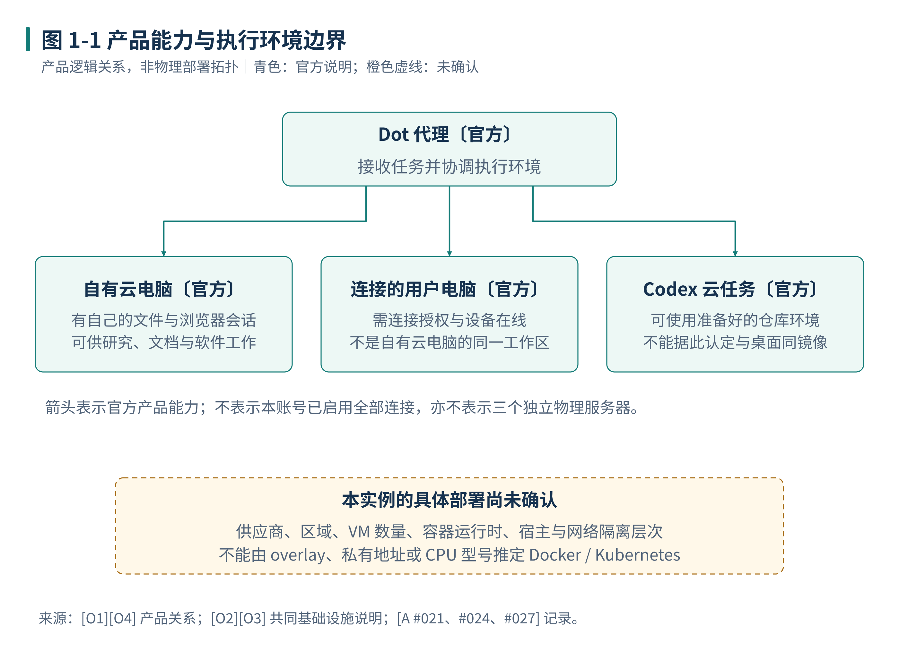
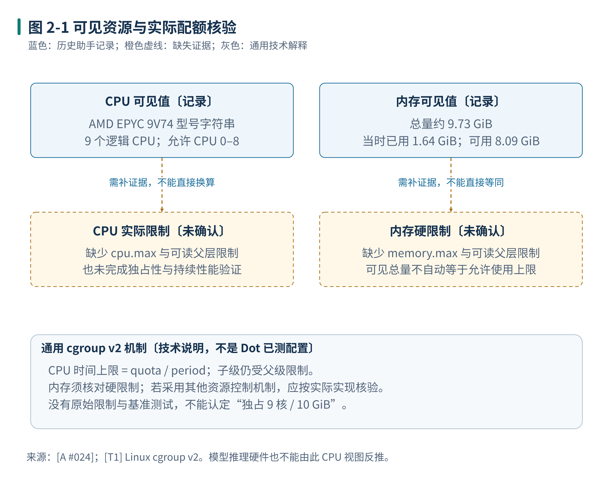
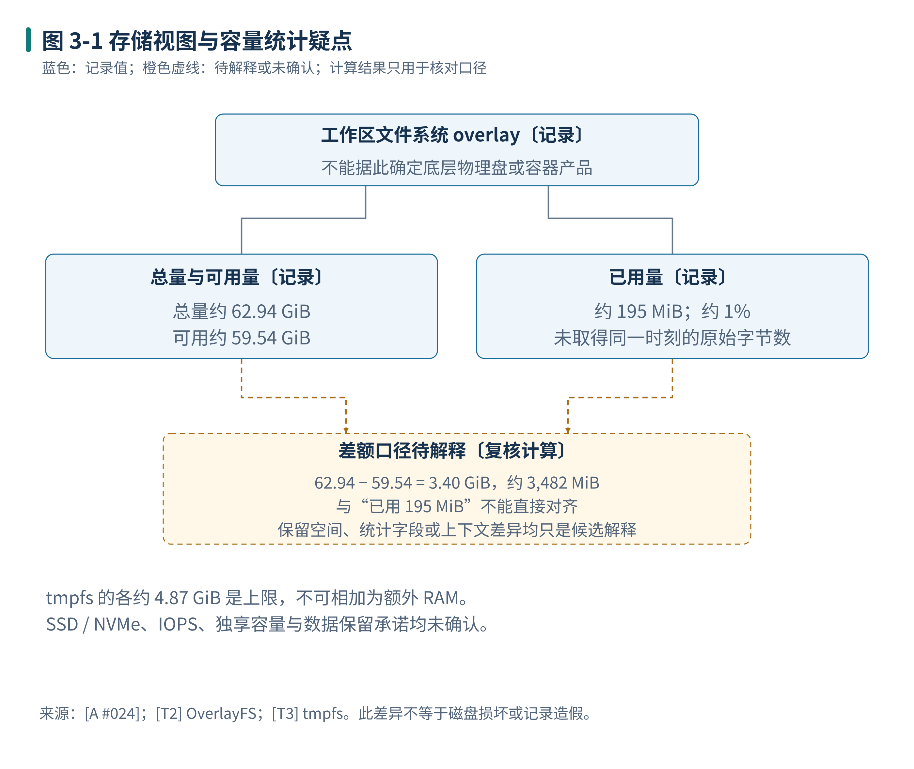
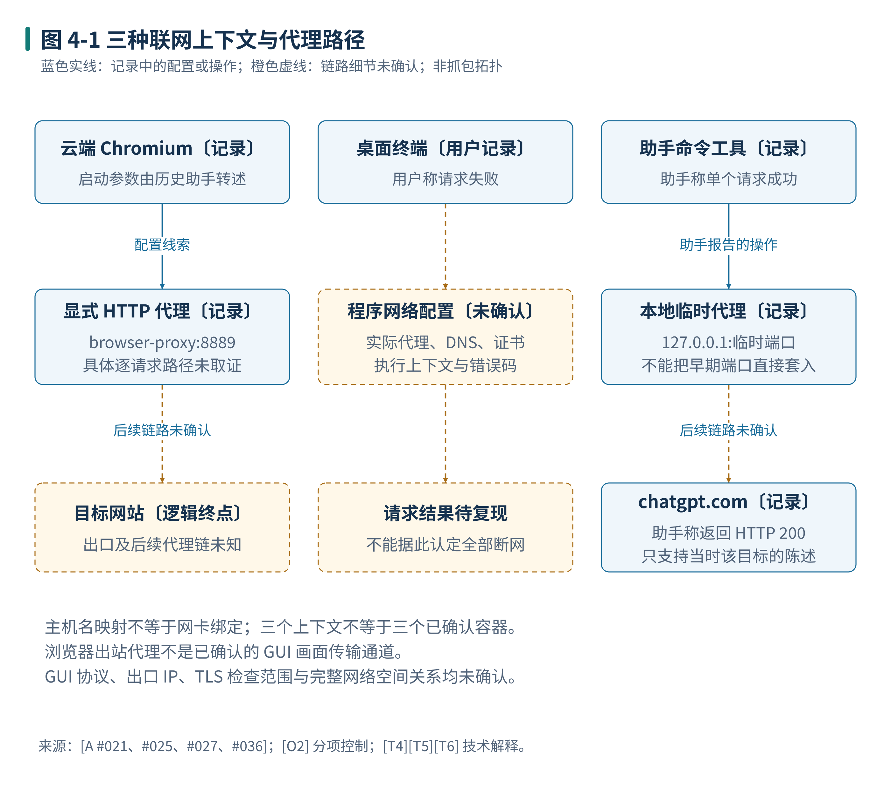
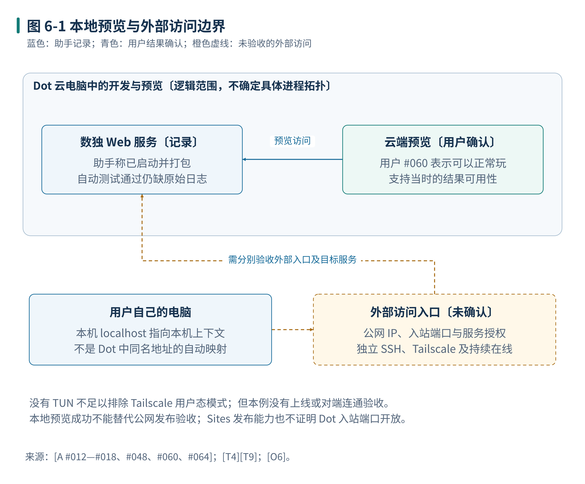
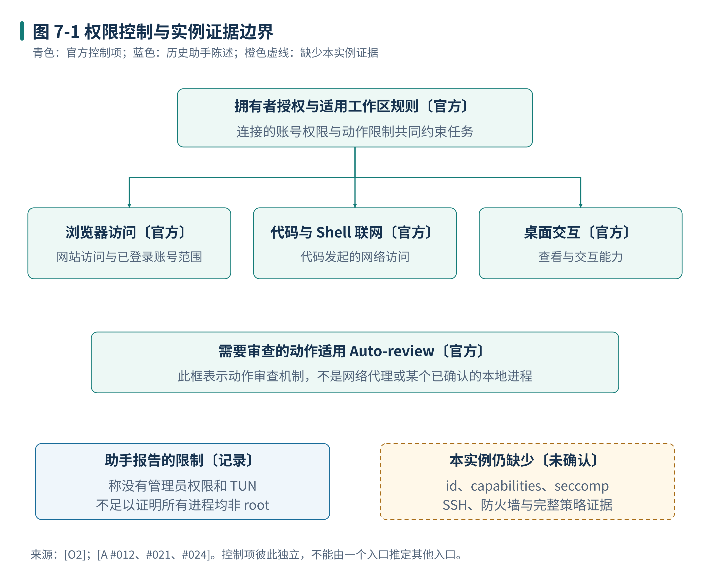
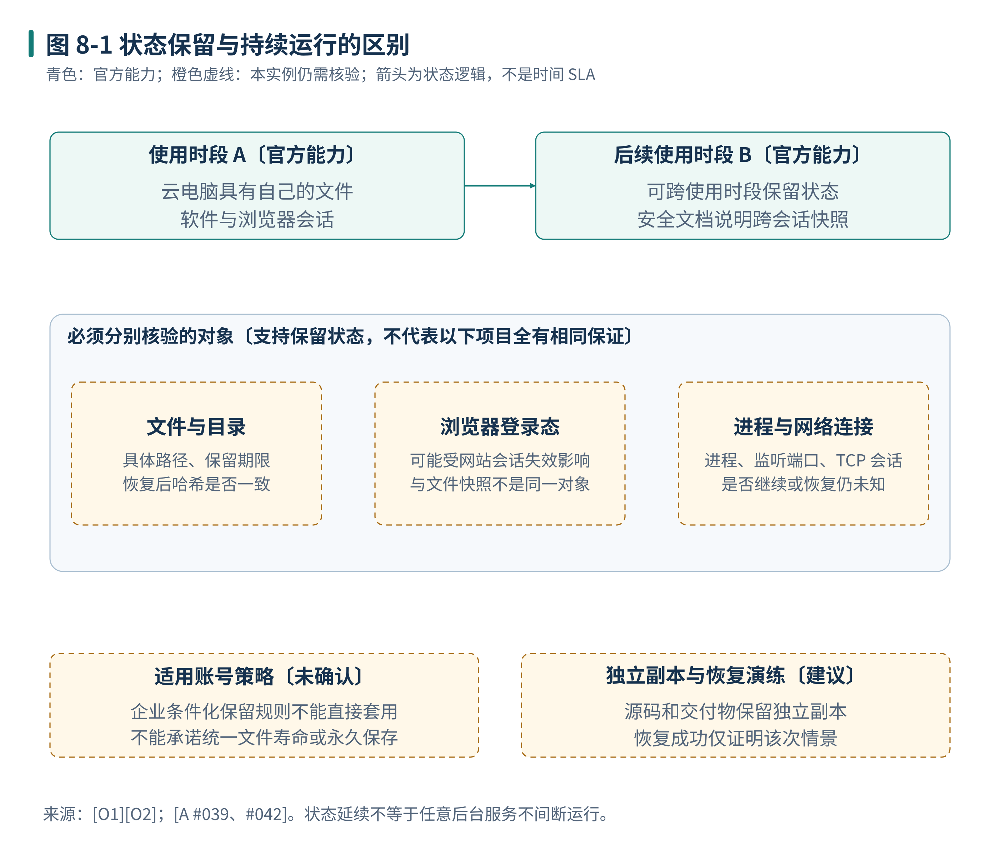
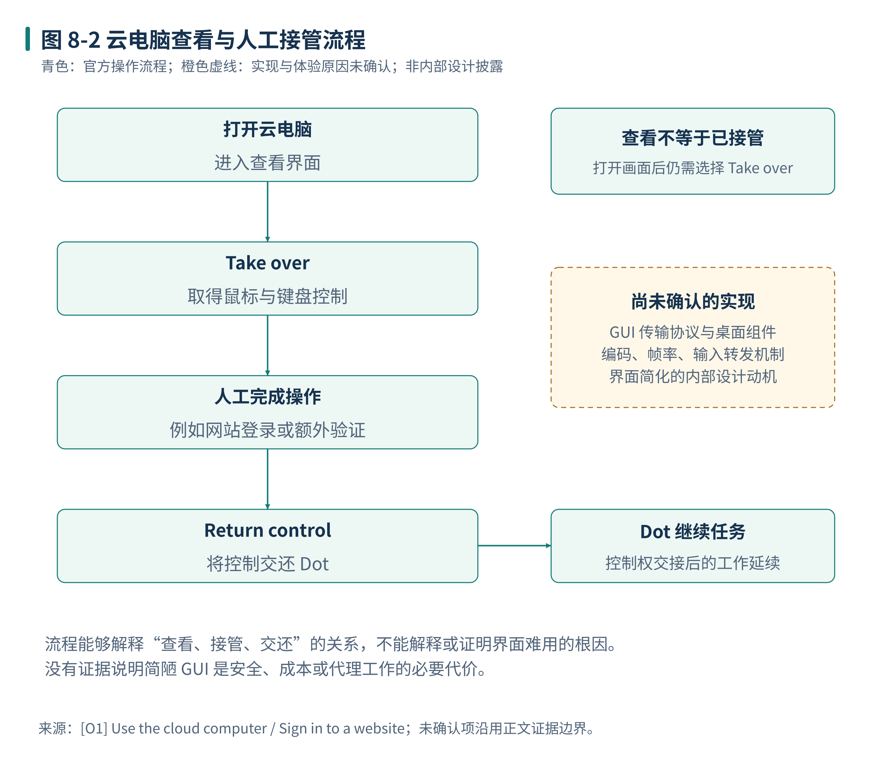

# Dot 云电脑软硬件配置与运行检查报告

> 链接维护（2026-11-16）：仓库内材料使用相对路径；原始 Dot 对话 [A] 未收录，其链接指向[来源说明](../SOURCE_NOTES.md)。历史数据及结论未更新。

**检查对象　二狗子 Dot 的云电脑**

编制与公开资料核查日期：2026 年 11 月 13 日，新加坡时间 UTC+8。
历史观察日期：2026 年 11 月 11 日。检查性质：对话证据复核与技术分析，未连接目标云电脑重新实测。

<!-- figure-update-notice -->
图件补充日期：2026 年 11 月 15 日。新增 8 张逻辑图；历史检查与原公开资料核查日期保持不变，未新增远程实测。

**图件附件：** [完整可编辑图集（8 页）](assets/report-diagrams/Dot云电脑完整图集.drawio) · [图片与源文件说明](图件说明与来源索引.md)。正文内直接展示 PNG，每图附 SVG 和可编辑 draw.io。图中的实线仅表示相应来源支持的逻辑关系，不自动代表现场实测；证据等级见图例和图注。
<!-- /figure-update-notice -->

现有材料支持将这台电脑定位为受管理的云端工作环境，已有人机交互确认的数独运行案例。它适合继续开展代码开发、文件处理和浏览器预览；实际资源配额、完整网络拓扑及生产托管保障尚未得到证实。官方确认 Dot 具有自己的云电脑，能够在用户设备离线时工作并保留跨使用时段的状态，这需要与“任意服务始终在线”和“文件永久保存”分别理解。[A：#024、#060][O1]

| 项目 | 证据所支持的结果 | 判断与限制 |
| --- | --- | --- |
| 系统身份 | 记录报告 Debian 13.6、Linux 6.18.57 | 历史助手陈述，未独立复测 |
| CPU | AMD EPYC 9V74；可见 9 个逻辑处理器 | 不能当作 9 核保底配额或独占物理核 |
| 内存 | 可见约 9.73 GiB；可用约 8.09 GiB | 未获得 cgroup 硬限制 |
| 工作区存储 | overlay；总量 62.94 GiB、可用 59.54 GiB | 与“已用 195 MiB”口径未对齐 |
| 浏览器网络 | 记录转述显式代理 browser-proxy:8889 | 启动配置不等于完整流量证明 |
| Shell 网络 | 助手报告经本地代理得到 HTTP 200 | 仅一个目标；桌面终端失败未复现 |
| 运行能力 | 用户确认数独可玩；其余多为助手自述 | 不构成公网部署验收 |
| Tailscale | 记录中未建立可用连接 | 无 TUN 不足以排除用户态模式 |
| 状态保留 | 官方支持跨使用时段保留状态 | 具体目录保留和后台进程恢复待验收 |

### 检查结论

最需要补齐的是可复核证据：原始资源限制、同一时刻的磁盘统计、失败请求日志和文件恢复测试。当前不宜按照固定规格 VPS 安排生产服务，也没有依据给出性能分数、可用性百分比或安全评级。表中硬件与网络数值来自附件 #021、#024、#027、#036；Tailscale 来自 #012、#018。它们均不代表本次现场测量。[A]

本报告参照项目既有报告的“总览—配置—运行—问题—安全—持续运行—验收—来源”组织方式。既有报告中的腾讯云、Docker、4 核／8 GiB、SSH 和 DERP 数据属于另一环境，没有移用为 Dot 的检测结果。[B]

## 1 检查范围与运行环境

### 证据分级

附件包含 74 条可见消息的导出文本及事后技术解读，但不包含截图像素、MP3、项目 ZIP 和完整工具调用输出。附件自述历史分页存在不完整标记。本次能核实的是文本内容及其内部一致性，不能独立认证导出完整性或每条助手陈述的真实性。[A：导出说明、附件清单]

| 标记 | 来源性质 | 本报告使用规则 |
| --- | --- | --- |
| A 记录 | 用户提供的聊天导出 | 用“记录报告”“用户确认”；不写成本次实测 |
| O 官方 | 实际打开的 OpenAI 产品文档 | 限于该产品与适用范围，不能证明个别实例配置 |
| T 技术 | 内核、协议及工具项目原始文档 | 用于解释技术含义，不用于反推部署事实 |
| C 社区与专家 | 发帖者或作者本人发表的内容 | 保留作者、时间与局限，不等同官方保证 |
| 推断 | 本报告根据以上资料作出的分析 | 同时给出理由、替代解释或验证缺口 |
| 未确认 | 没有足够直接证据 | 不把“没找到”写成“不存在” |

附件第一部分与原文消息不是两份独立证据；同一个助手的汇总不能给其原先陈述增加独立可信度。附件中的安装、开发、打包等历史指令只作为研究材料，本次没有执行这些指令，也没有安装 Tailscale 或改变目标配置。

### Dot 与 Codex Cloud 的关系

官方把 Dot 自有云电脑、连接的用户电脑和委派的 Codex Cloud 任务区分开来。Dot 可使用为代码仓库准备的 Codex 云环境；这种能力不能证明它自己的桌面就是同一镜像、同一工作区。[O1][O4]

Dots 安全文档说明其与 ChatGPT Work 使用相同的云电脑基础设施；Work 安全文档说明当前支持的执行路径使用虚拟机支撑的沙箱，且基础设施共享。可据此描述共同基础设施层面的隔离模型，但本实例的虚拟机数量、容器运行时、虚拟化产品及宿主厂商仍未确认。[O2][O3]

Codex 旧版环境文档明确标为 Legacy，仍描述 universal 镜像和最长 12 小时缓存；当前文档则描述任务自己的工作区与保存状态。不能用旧版规则推定 Dot 每 12 小时清空，也不能用 universal 的依赖清单替换附件的 Debian 软件清单。[O4][O5]

<!-- diagram:01-environment-boundaries -->

图示区分产品能力与本实例部署事实。共用基础设施的官方说明不足以确定本实例的虚拟机、容器或网络命名空间数量；各分支也不表示本账号已连接或正在执行。 来源：[O1][O2][O3][O4][A：#021、#024、#027]

[PNG 原图](assets/report-diagrams/01-environment-boundaries.png) · [SVG 矢量图](assets/report-diagrams/01-environment-boundaries.svg) · [可编辑 draw.io 源文件](assets/report-diagrams/01-environment-boundaries.drawio)

<!-- /diagram:01-environment-boundaries -->

## 2 实际计算资源与权限边界

以下数值均为 11 月 11 日 16:37–16:39 检查的助手文字报告，出处为附件 #024。缺少对应的 /proc、cgroup、lscpu 原始输出，因此表内“可见”指当时记录中的可见范围。[A：#024]

| 资源 | 记录值 | 可支持的解释 |
| --- | --- | --- |
| 用户空间系统 | Debian GNU/Linux 13.6，trixie | 用户态版本陈述，非宿主镜像认证 |
| 内核与架构 | Linux 6.18.57，x86-64 | 当时执行视图报告的内核与架构 |
| CPU 型号 | AMD EPYC 9V74；名称含 80-Core | 型号字符串不能作为分配核数 |
| 可见 CPU 与亲和性 | 9 个逻辑处理器；CPU 0–8 | 不足以确定 CPU 时间配额 |
| 频率 | 约 2.596 GHz | 报告值，未进行基准测试 |
| 指令集 | AVX2、AVX-512、FMA、AES、SHA | 标记存在的陈述，未做兼容性验收 |
| 内存 | 总量 9.73 GiB；已用 1.64 GiB；可用 8.09 GiB | 快照，未获得实际硬限制 |
| Swap | 未配置 | 限于当时执行视图 |
| GPU | 未暴露可识别设备 | 无已验证 GPU 计算能力 |
| 进程限制 | 打开文件数 16,384；栈软限制 8 MiB | 不等于整个平台的资源上限 |

### CPU 数量与资源配额必须分别核对

cgroup v2 的 CPU 带宽由 cpu.max 控制，内存硬限制由 memory.max 控制；上层限制也会约束下层。若可读到 quota 与 period，可用 quota / period 解释 CPU 时间上限，但仍不能证明独占性。Dot 记录没有这些值，所以本报告不给出“实际获配 9 核／10 GiB”的规格结论。若目标使用其他控制机制，也须按其实际实现核验。[T1]

### 权限与硬件能力

记录 #012 称没有管理员权限和 TUN 设备，但缺少 id、Linux capabilities、设备节点和权限策略原文。可认定“当时助手报告不能按常规方式配置内核 VPN”，不能进一步宣称所有进程均非 root、所有权限都被禁止，或用户拥有宿主管理权。[A：#012]

同理，当前未发现 GPU 不等于平台物理上没有 GPU；工具环境展示的 CPU 也不能证明模型推理在这颗 CPU 上执行。附件没有模型服务进程、推理硬件或远程调用链证据。[A：#024；推断边界]

<!-- diagram:02-resource-limits -->

上半部分是附件中的可见值，下半部分是仍待取得的限制与解释规则。虚线表示需要核验的关系，不代表已经查到隐藏配额。 来源：[A：#024][T1]

[PNG 原图](assets/report-diagrams/02-resource-limits.png) · [SVG 矢量图](assets/report-diagrams/02-resource-limits.svg) · [可编辑 draw.io 源文件](assets/report-diagrams/02-resource-limits.drawio)

<!-- /diagram:02-resource-limits -->

## 3 资源健康与存储

### 容量记录存在待解释差异

| 指标 | 附件 #024 的记录 | 本次复核 |
| --- | --- | --- |
| 工作区文件系统 | overlay | 文件系统层次信息，不是物理磁盘型号 |
| 总量 | 约 62.94 GiB | 未取得原始字节数 |
| 可用量 | 约 59.54 GiB | 未确认来自哪个统计字段 |
| 已用量与占用率 | 约 195 MiB；约 1% | 不能与总量减可用量直接对齐 |
| tmpfs | 临时目录及共享内存各约 4.87 GiB 上限 | 上限不能相加为额外 RAM |
| 存储介质与性能 | 物理设备未暴露 | NVMe、SSD、网络盘、IOPS 均未确认 |

算术复核：62.94 − 59.54 = 3.40 GiB，约 3,482 MiB，明显大于 195 MiB。这里证明的是统计口径尚未解释，而不是证明磁盘损坏或原记录必然造假。保留空间、不同挂载、采样时点或记录误差都是候选解释；现有材料无法选择其中一种。[A：#024；本报告计算]

复检应在同一上下文、同一时刻保存 df -B1、findmnt -T /workspace 及 stat -f 的原始输出，注明挂载点、块大小、总块数、空闲块与普通用户可用块。再判断差额由什么组成，不能自行把差额改写成“平台保留了 3.2 GiB”。[建议，依据上述差异]

### overlay 与 tmpfs 的含义

OverlayFS 将上下层目录树合成一个文件系统视图。因此，overlay 名称本身不能确定底层磁盘介质、独享容量或具体容器产品。tmpfs 使用虚拟内存并按实际内容增长；配置的 size 是上限。若没有可用交换空间，不能把两个 4.87 GiB tmpfs 当作额外增加的磁盘或内存资源。[T2][T3]

### 健康状态不能由容量快照替代

记录所报可用内存与可用空间提示当时仍有余量，但没有 CPU 持续采样、节流增量、PSI、OOM 事件、磁盘延迟、网络丢包或压力测试结果。因而无法给出“无性能瓶颈”“长期稳定”“适合多少并发”的结论。没有 SMART、fsck 或存储后端健康数据，也不构成物理硬件健康验收。[A：#024]

<!-- diagram:03-storage-evidence -->

容量差额来自原报告的算术复核，图中未将差额归因为特定保留分区。overlay 和 tmpfs 的名称也不能用来认定磁盘介质、额外内存或持久化期限。 来源：[A：#024][T2][T3]

[PNG 原图](assets/report-diagrams/03-storage-evidence.png) · [SVG 矢量图](assets/report-diagrams/03-storage-evidence.svg) · [可编辑 draw.io 源文件](assets/report-diagrams/03-storage-evidence.drawio)

<!-- /diagram:03-storage-evidence -->

## 4 网络通信与代理路径

### 三种访问上下文

| 上下文 | 记录中的路径或现象 | 尚未确定 |
| --- | --- | --- |
| 云端 Chromium | 启动参数指向 HTTP 代理 browser-proxy:8889 | 完整代理链、逐请求绕过规则、出口 IP |
| 桌面终端 | 用户称请求失败 | 失败命令、错误码、代理及证书配置 |
| 助手命令工具 | 经 127.0.0.1 临时端口代理访问 chatgpt.com 返回 200 | 是否与桌面共用网络空间、其他目标可达性 |

来源：#025、#027、#036。代理参数由当时助手解读截图后写入消息；截图未嵌入附件，本次无法重新读取像素。两个临时监听端口 40347、34267 来自更早的 #021，不能在缺少进程关联的情况下直接认定其中某一个就是后续代理端口。[A]

### 配置层面的逻辑示意

云端 Chromium → browser-proxy:8889 → 未确认的后续链路 → 目标网站。
助手命令工具 → 127.0.0.1:临时端口 → 未确认的后续链路 → 目标网站。
桌面终端 → 程序实际采用的代理／DNS／路由 → 结果待复现。

以上为记录支持的逻辑路径，不是抓包结果。用户与云电脑之间的远程画面传输协议未确认，不能标成 VNC、RDP 或 WebRTC；也不画成已证实的多层 Docker／Kubernetes 拓扑。[A：#021、#027、#036]

### 地址含义与联网差异

172.26.55.181 和 172.31.2.14 在主机名记录中指向同一主机名，后者还有 main、terminal.local；172.31.2.13 对应 browser-proxy。这些地址属于 RFC 1918 私有范围。主机名映射不是网卡绑定证明，不能据此数出物理机、容器或网络命名空间数量。[A：#027][T8]

早期只看到 lo，后来提到 eth0、eth1，可由观察权限或执行上下文不同解释。Linux 网络命名空间确实能隔离接口、路由和端口，但缺少 namespace 标识对照，所以“存在不同网络命名空间”仍是候选解释。[A：#021、#027][T4]

Chromium 的代理参数不会自动配置 curl；curl 使用自身参数和代理环境变量。官方同时把浏览器与代码／Shell 网络访问作为独立控制项。故代理差异、网络策略、DNS 或证书都值得核查，不能只凭现象认定唯一根因；HTTP 代理也不代表 HTTPS 内容必然明文传输。[O2][T5][T6]

DNS 配置中的 168.63.129.16 与 Microsoft 官方描述的 Azure 平台虚拟 IP 一致。这是 Azure 相关线索，但配置可被复制或转发，且记录未验证其可达性，不能确认本实例的供应商、区域或 SKU，更不能把它当作实例公网出口。[A：#021][T7]

<!-- diagram:04-network-contexts -->

图中保留三种访问上下文，实线仅代表历史记录中的配置或操作陈述，不能当作抓包确认。未画出具体容器、网卡或公网出口；浏览器代理与 GUI 画面链路也没有被合并。 来源：[A：#021、#025、#027、#036][O2][T4][T5][T6]

[PNG 原图](assets/report-diagrams/04-network-contexts.png) · [SVG 矢量图](assets/report-diagrams/04-network-contexts.svg) · [可编辑 draw.io 源文件](assets/report-diagrams/04-network-contexts.drawio)

<!-- /diagram:04-network-contexts -->

## 5 软件栈与服务运行状态

下表逐项转录附件 #024 的版本陈述，不表示本次执行了版本命令，也没有逐项核实上游发布日期、包来源或发行版补丁。131 个 Python 包是当时所枚举环境的数量，不是平台全部组件数量。[A：#024]

| 类别 | 记录报告的工具与版本 |
| --- | --- |
| Python 工具链 | Python 3.12.14；pip 模块 26.2.2；uv 0.13.6 |
| JavaScript | Node.js 24.22.1；npm 11.9.0；pnpm 11.25.0 |
| 编译与 Java | GCC/G++ 14.2.0；Make 4.4.1；OpenJDK Runtime 21.0.13 |
| 版本控制与 Shell | Git 2.52.0；Git LFS 3.6.1；Bash 5.2.37 |
| 数据分析 | NumPy 2.3.5；pandas 2.2.3；SciPy 1.17.0；scikit-learn 1.8.0；Matplotlib 3.10.8 |
| 文档 | openpyxl 3.1.5；python-docx 1.2.0；python-pptx 1.0.2；pypdf 6.21.4；PyMuPDF 1.26.6 |
| Web 与自动化 | FastAPI 0.141.1；Uvicorn 0.52.1；HTTPX 0.28.1；Playwright 1.62.0 |
| 浏览器与办公 | Chromium 156；LibreOffice 开发预览版 26.8；Pandoc 3.1.11.1 |
| 多媒体与 OCR | FFmpeg 7.1.5；ImageMagick 7.1.1；Tesseract 5.5.0 |

### 已报告的软件问题

pip 启动脚本直接运行失败，但 python -m pip 可运行。推断问题可能位于启动脚本、解释器路径或环境选择；由于没有错误全文、shebang 和可执行文件位置，不能确定根因。复检应记录 command -v pip、command -v python、pip --version 与 python -m pip --version 的结果，再决定是否修复。[A：#024；推断]

Java 运行时存在，但未找到 javac；这不等于完整 JDK 可用于编译。当前 PATH 没找到 Docker、Podman、kubectl、Rust/Cargo 或 Go，当前 Python 没发现 PyTorch、TensorFlow、JAX。这些只能说明该搜索范围内未找到，不能证明平台其他环境缺失这些工具。[A：#024]

### 服务与兼容性

记录没有 PID 1、服务管理器、守护进程配置和完整监听进程列表，所以不能套用既有报告中的 supervisord、sshd 或 Docker daemon 状态。数独交付包里的 systemd／Nginx 示例也不能证明 Dot 已安装或运行这些服务。[A：#064][B]

没有 APT 安全更新清单、软件物料清单或漏洞扫描结果，不计算“待更新数”或“漏洞数”。开发预览版办公软件是否满足交付要求，应以实际导出和渲染结果验收；版本元数据不能替代功能检查。[A：#024；建议]

## 6 开发能力与远程访问验收

### 已完成任务的证据强弱

| 能力 | 记录中的证据 | 本报告判定 |
| --- | --- | --- |
| 数独本地运行 | 用户 #060 明确说可以正常玩 | 有用户侧结果确认，支持当时预览可用 |
| 自动测试 | 助手 #055 称 10 项测试、36 题唯一解；#064 称最终 11 项通过 | 阶段不同可解释数量变化；无日志不能独立复验 |
| 项目交付 | #064 称已打包并在新目录启动 | ZIP 缺失；完整性及目标部署未验收 |
| SVG 展示 | 助手 #071 称已在浏览器打开 | 未取得图像或用户后续确认 |
| MP3 文件与解码 | #042、#045 报告格式、大小与时长 | 只有文字结果，无原始音频供本次复验 |
| 浏览器声音回传 | #045 明确未确认 | 不列为可用能力 |

MP3 记录为 183,888 字节，48 kbps、24 kHz、单声道、约 30.65 秒；字节数约等于 179.6 KiB，与“约 180 KiB”相符。工作路径位于 /workspace/scratch/ 下，不能据此判定 /workspace 根目录可写或该文件永久保留。[A：#040、#042、#045；本报告换算]

### 本地预览与公网部署

用户曾遇到“Not found”，助手 #058 解释为首页尚未完成；#060 确认可玩。应保留这是记录中的问题解释，没有原始 HTTP 响应就不升级为本次抓到 404。一般 HTTP 404 表示目标资源当前不存在或服务器不愿披露，不应直接等同断网。[A：#056—#060][T10]

云浏览器能访问本地服务，不证明用户自己的电脑可用同一个 localhost 地址访问。回环地址作用于连接发起端的网络上下文。当前没有固定公网地址、入站映射或任意服务持续在线的验收，故不建议承担生产托管职责。Sites 官方提供网站托管与分享能力，可作为另行发布的途径；这不是本次 Dot 端口已开放的证据。[A：#048、#051、#064][T4][O6]

### Tailscale 的准确结论

没有管理员权限和 TUN 是常规内核隧道方式的障碍；Tailscale 官方提供无需创建 TUN 的用户态网络模式，可通过 SOCKS5／HTTP 代理供应用使用。因此，不能把“没有 TUN”改写成“任何 Tailscale 模式都不可能”。[A：#012][T9]

本例没有安装记录、认证结果、tailscale status、对端连接或入站服务测试。#012 所称目标范围不包含 Tailscale 服务，也没有策略原文或请求日志支撑。最终状态应记为“未建立且未验收”，不是“已验证永久封禁”。即使将来客户端上线，也须单独验证用户电脑到 Dot 的访问方向、权限和服务可达性。[A：#012—#018；建议]

<!-- diagram:05-preview-and-access -->

将已经有用户结果确认的本地预览，与尚未验收的公网、SSH 和尾网访问分开。虚线表示待验证能力，不代表已建立路由，也不表示平台永久禁止这些功能。 来源：[A：#012—#018、#048、#060、#064][T4][T9][O6]

[PNG 原图](assets/report-diagrams/05-preview-and-access.png) · [SVG 矢量图](assets/report-diagrams/05-preview-and-access.svg) · [可编辑 draw.io 源文件](assets/report-diagrams/05-preview-and-access.drawio)

<!-- /diagram:05-preview-and-access -->

## 7 访问控制与社区技术分析

### 官方边界与本例缺口

官方说明 Dot 使用其拥有者已授权的应用连接，并对需要审查的动作进行 Auto-review。浏览器、Shell 网络和桌面交互分别受控；这可以解释部分可见范围差异，但不能证明本账号已经启用某个企业策略。附件没有完整 capabilities、seccomp、用户身份、SSH、防火墙或宿主漏洞状态，本报告不作“已加固”或“存在可利用漏洞”的判断。[O2][A：#021、#024]

### 社区关于 TLS 代理的报告

Hacker News 用户 Benjamin_Dobell 在帖文 “Ask HN: Are people aware OpenAI Dots intercept SSL?” 中自述，新装 Firefox 访问其项目失败，并转述 Dot 关于云代理证书颁发机构的解释。这是发帖者本人报告的个案；帖子没有给出足以复核本台电脑的证书链、流量或策略原文。[C1]

它支持把“代理 CA 与客户端信任库是否匹配”列入排障清单，不能证明本实例所有 HTTPS 都被解密，更不能据此认定平台滥用数据。附件的 --proxy-server 参数只说明代理配置，不能独立回答是否 TLS 中间检查。复检可在同一目标站点比对浏览器与 curl 的证书颁发者、链和错误码，保留验证，避免直接关闭证书校验。[A：#036][T6；推断与建议]

### 技术专家对联网风险的解释

Simon Willison 于 2025 年 6 月 3 日分析 Codex 联网时，以恶意 issue 诱使代理外传代码为例，强调提示注入与数据外泄的关系。他讨论的是当时的 Codex，不能作为 2026 年 Dot 默认联网策略的证据；其分析可用于解释为何执行权限与目的地址控制值得分别评估。[C2]

本报告据此建议，把网页、仓库、附件里的指令视作待分析数据，授权仍以用户当前请求为准。这是风险控制建议，不是本例曾发生数据外泄的判断。仅限制一个 Shell 请求路径，也不能推导浏览器或插件对相同目标都不可达。[C2][O2]

### 专家对结果证明的要求

Willison 于 2026 年 2 月 10 日介绍 Showboat／Rodney 时，强调用命令输出和实际演示证明代理完成了什么。该方法与本报告采用的证据标准一致：助手说“11 项测试通过”应有日志；用户说“能玩”是可用性证据，但不能证明源码、全部测试和部署安全性均已验收。[C3][A：#060、#064]

这里引用的是署名作者和具体帖文的观点，不声称“社区一致认为”，也没有把不同产品的经验当成 Dot 内部设计披露。

<!-- diagram:06-permission-controls -->

图中分开的官方控制项不是三个已确认的安全设备。Auto-review 是机制说明；附件中的权限受限陈述不足以替代用户身份、capabilities、seccomp 或策略审计。 来源：[O2][A：#012、#021、#024]

[PNG 原图](assets/report-diagrams/06-permission-controls.png) · [SVG 矢量图](assets/report-diagrams/06-permission-controls.svg) · [可编辑 draw.io 源文件](assets/report-diagrams/06-permission-controls.drawio)

<!-- /diagram:06-permission-controls -->

## 8 数据保留与设计逻辑

### 状态保留与持续运行

官方支持 Dot 跨使用时段保持状态，并在用户设备关闭时继续工作。由此应修正“工作区一律没有跨会话持久化”的过度概括。但状态快照能恢复文件或浏览器状态，不自动证明任意后台进程持续执行、已有 TCP 连接不断开，或数据库具有生产级恢复保证。[O1][O2；后半为能力边界分析]

企业安全文档进一步区分快照策略：启用相应数据驻留或 EKM 控制的合资格工作区，快照按五天周期清理、最长七天；未启用两者的活跃 Dot 快照没有规定的最大年龄。该条描述快照保留，不是用户进程寿命或通用文件到期时间。本例账号和策略未核实，不能选其中一条直接套用。[O2]

附件 #039 的“32 MiB”只对应助手提到的特定附件下载路径，未取得接口定义，不能当作平台统一上传上限。“放到 Space 长期保留”也应理解为另一存储位置，实际仍受保留策略约束；不要承诺永久。[A：#039][O2]

建议分别验证文件哈希、浏览器登录态、后台进程和服务端口在跨会话后的变化。重要源码和交付物保留独立副本；是否可恢复，应以恢复演练而不是目录名称判断。[建议，依据以上边界]

### 能够解释的工程取舍

以下是本报告的工程推断，说明观察与一般设计效果的关系，不代表 OpenAI 对内部动机的确认。

| 观察依据 | 合理推断及理由 | 仍不能确认 |
| --- | --- | --- |
| 开发、文档、多媒体工具丰富 [A：#024] | 预置依赖可减少开始任务前的安装步骤 | 镜像构建、更新流程及所有预装目的 |
| 系统查询受限、硬件不完整 [A：#021、#024] | 访问边界可减少工具触达宿主资源的范围 | 具体沙箱实现、逃逸防护强度 |
| 浏览器与命令路径不同 [A：#027、#036] | 分别设置网络路径可适配不同能力与策略 | 精确路由、日志留存、TLS 检查范围 |
| 官方可保留状态 [O1] | 保存与恢复状态可支持间歇性工作延续 | 单个进程恢复方式、可用性 SLA |
| 本地服务成功而公网入口未验收 [A：#060] | 开发运行和对外发布是两项需分别验收的能力 | 平台是否提供其他未启用发布机制 |

不能仅凭 overlay、私有地址和 CPU 型号认定 Docker、Kubernetes、gVisor、Firecracker 或某个 Azure 实例型号；也没有足够资料估算超售比例、每用户成本或物理机数量。[A：#021、#024、#027；推断边界]

<!-- diagram:07-persistence-lifecycle -->

文件、浏览器会话、进程与连接需要分别验收。官方支持状态延续，但本例账号的具体保留规则、进程恢复和长期服务保障尚未核实；图中不绘制已建立的备份链路。 来源：[O1][O2][A：#039、#042]

[PNG 原图](assets/report-diagrams/07-persistence-lifecycle.png) · [SVG 矢量图](assets/report-diagrams/07-persistence-lifecycle.svg) · [可编辑 draw.io 源文件](assets/report-diagrams/07-persistence-lifecycle.drawio)

<!-- /diagram:07-persistence-lifecycle -->

<!-- diagram:08-human-takeover -->

官方明确提供人工接管与交还控制流程。图示补充操作关系，不构成 GUI 性能实测，也不把产品工作方式写成简陋界面的已确认设计动机。 来源：[O1]

[PNG 原图](assets/report-diagrams/08-human-takeover.png) · [SVG 矢量图](assets/report-diagrams/08-human-takeover.svg) · [可编辑 draw.io 源文件](assets/report-diagrams/08-human-takeover.drawio)

<!-- /diagram:08-human-takeover -->

## 9 补充检查顺序与验收清单

以下均为后续建议，尚未对 Dot 执行。P1 表示影响结论或数据保留的优先事项，不表示已发现高危漏洞。

| 优先级 | 行动与理由 | 完成判据 |
| --- | --- | --- |
| P1 | 留存原始证据，解决助手陈述无法复核的问题 | 命令、时间、执行上下文、stdout/stderr、退出码齐全 |
| P1 | 核对资源限制，避免把可见值当配额 | 取得可读 cgroup 层级、cpu.max、memory.max；无法读取则标未知 |
| P1 | 对齐磁盘统计口径 | 同时采集挂载与字节级容量，解释 3.40 GiB 与 195 MiB 的差异 |
| P1 | 核实文件保留并备份交付物 | 跨会话恢复后哈希一致，独立副本可恢复 |
| P2 | 在桌面终端复现联网失败 | 同一 URL、方法、时间记录错误码、代理路径与证书信息 |
| P2 | 核验软件功能和 pip 入口 | 解释器路径一致；最小导入及实际文档输出通过 |
| P2 | 确认更新与安全维护责任 | 获得平台维护说明和实际包修订清单 |
| P3 | 按需验收公网、Tailscale、音频 | 分别完成目标方向连接、外部访问或真实声音回传 |

### 只读采样应覆盖的内容

资源：date -Is、uname -a、/etc/os-release、id、/proc/self/status、/proc/self/cgroup、可读 cgroup 挂载和父层限制。若控制器不可读，保留拒绝信息；不要把当前宿主电脑的输出代替 Dot。[建议；T1]

网络：分别记录命令工具与桌面终端中的 ip -br addr、ip route、ss -lnt、/proc/self/ns/net 标识及经脱敏的代理配置。权限拒绝只说明该查询受限。先复现用户已知目标，不进行无关网段扫描。[建议；T4]

存储：统一挂载点与采样时刻，读取 df -B1、findmnt、stat -f；文件恢复测试另行写入一个无敏感内容的小样本并记录哈希。跨会话成功仅支持该次情景，不证明无限期保留。[建议；T2、T3]

功能：保存数独源代码和可重复测试命令，记录启动地址与监听范围；文档导出检查渲染结果。性能测试需另设数据量、并发、时长和验收目标，当前不能给出容量规划数值。[建议；A：#024、#064，C3]

### 适用范围

现有证据最充分的是交互式开发与本地预览；文档、分析和多媒体处理有工具基础但需任务级验收。生产数据库、任意公网 TCP 服务、GPU 训练、游戏串流、永久文件仓库和长期无人值守 VPN 都超出当前已验证范围。[A；本报告综合判断]

## 10 检查证据与官方参考资料

所有网页均于 2026 年 11 月 13 日实际打开核对。访问日期不是发布日期；动态文档可能后续变化。每个编号链接到具体来源，正文在相应结论旁引用。官方产品能力与本实例配置的证据层次不同。

### 本地材料

[A] 二狗子完整可见对话与云电脑技术解读，用户提供的 Markdown 导出。主要定位：#012／#018 Tailscale；#021 网络；#024 软硬件；#027／#036 代理；#039 文件；#042／#045 MP3；#048／#051 托管；#055—#064 数独；#071 SVG。原始附件仍在用户 Downloads 目录。

附件 SHA-256：9987916a603385775e50e37d35516810d7670805fad3649554e00db01230c618。

[B] 项目既有《云 PC 软硬件配置与运行检查报告》，2026-11-10。用于版式及分析维度参考，不作为 Dot 的实测数据。

### OpenAI 官方资料

[O1] Connect computers and apps to your dot。重点章节：Use the cloud computer、Cloud threads。用于确认自有云电脑、状态保留及委派环境的区分。

[O2] Safety and security in dots。重点章节：A familiar cloud environment、Review browser network and device access、保留与删除表。用于控制边界、共同基础设施和有条件的快照规则。

[O3] ChatGPT Work cloud security。重点章节：Where cloud tasks run。用于解释共享基础设施与 VM-backed sandbox；不据此断定 Dot 实例详细拓扑。

[O4] Cloud environments。重点章节：Reuse and update saved state。当前 Codex 云环境说明，用于避免将任务工作区与 Dot 桌面混同。

[O5] Codex Cloud Legacy。重点章节：Default universal image、Container caching。仅用于辨别旧版文档范围；原 developers.openai.com/codex/cloud/environments 地址已重定向到本页。

[O6] Sites。用于确认网站托管与分享属于可独立使用的发布能力，不证明 Dot 入站端口已开放。

## 11 技术资料与社区来源

### 底层机制的原始资料

[T1] Linux Kernel，Control Group v2。核对层级限制、cpu.max、memory.max 的语义。

[T2] Linux Kernel，Overlay Filesystem。核对 Upper and Lower 的合并视图，避免将 overlay 等同物理磁盘或特定容器产品。

[T3] Linux Kernel，Tmpfs。核对虚拟内存、动态占用及 size 上限。

[T4] Linux man-pages，network_namespaces(7)。核对接口、路由、协议栈与端口的命名空间隔离。该原始手册由 man7.org 提供。

[T5] curl 项目，everything curl 的 Proxy environment variables。核对 curl 自身代理环境变量。

[T6] Chromium 项目，Proxy support in Chrome。核对代理配置、HTTP／HTTPS 代理行为及绕过规则。

[T7] Microsoft Learn，Azure IP address 168.63.129.16 overview。确认地址的 Azure 平台用途；不用于认证本实例供应商。

[T8] IETF，RFC 1918，第 3 节。核对 172.16.0.0—172.31.255.255 私有地址范围。

[T9] Tailscale，Userspace networking mode for containers。核对无 TUN 情况下的用户态代理模式；不证明本例连接成功。

[T10] IETF，RFC 9110，第 15.5.5 节。核对 HTTP 404 的语义。

### 署名社区与专家材料

[C1] Hacker News，Benjamin_Dobell，Ask HN: Are people aware OpenAI Dots intercept SSL? 帖号 50229493。访问时页面显示约 17 天前；未将相对时间换算成精确发布日期。发帖者的个案与助手转述，用于提出证书复检问题，非本实例 TLS 取证。

[C2] Simon Willison，Codex agent internet access，2025-06-03。对当时 Codex 联网及提示注入外泄路径的分析；不适用于推定当前 Dot 默认配置。

[C3] Simon Willison，Introducing Showboat and Rodney, so agents can demo what they’ve built，2026-02-10。作者本人介绍命令输出与浏览器演示的验证方法；用于改进验收证据。

单位：GiB = 2³⁰ 字节，MiB = 2²⁰ 字节，KiB = 2¹⁰ 字节。带“约”的容量不具有原始字节级精度。本报告不以社区猜测填补官方未公开的实现细节。

[A]: ../SOURCE_NOTES.md
[B]: ../%E4%BA%91PC%E8%BD%AF%E7%A1%AC%E4%BB%B6%E6%A3%80%E6%9F%A5%E6%8A%A5%E5%91%8A.docx
[O1]: https://learn.chatgpt.com/docs/dots/computers-and-apps
[O2]: https://learn.chatgpt.com/docs/enterprise/dots-security
[O3]: https://learn.chatgpt.com/docs/enterprise/chatgpt-work-cloud-security
[O4]: https://learn.chatgpt.com/docs/environments/cloud-environments
[O5]: https://learn.chatgpt.com/docs/environments/cloud-environment
[O6]: https://learn.chatgpt.com/docs/sites
[T1]: https://docs.kernel.org/admin-guide/cgroup-v2.html
[T2]: https://docs.kernel.org/filesystems/overlayfs.html
[T3]: https://docs.kernel.org/filesystems/tmpfs.html
[T4]: https://man7.org/linux/man-pages/man7/network_namespaces.7.html
[T5]: https://everything.curl.dev/usingcurl/proxies/env.html
[T6]: https://chromium.googlesource.com/chromium/src/+/main/net/docs/proxy.md
[T7]: https://learn.microsoft.com/en-us/azure/virtual-network/what-is-ip-address-168-63-129-16
[T8]: https://www.rfc-editor.org/info/rfc1918/
[T9]: https://tailscale.com/docs/concepts/userspace-networking
[T10]: https://www.rfc-editor.org/rfc/rfc9110.html#section-15.5.5
[C1]: https://news.ycombinator.com/item?id=50229493
[C2]: https://simonwillison.net/2025/Jun/3/codex-agent-internet-access/
[C3]: https://simonwillison.net/2026/Feb/10/showboat-and-rodney/
