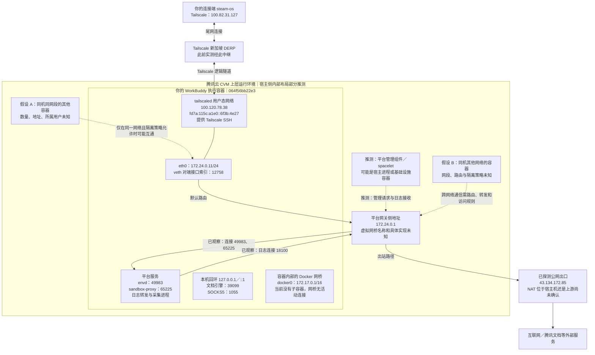

# WorkBuddy 容器网络逻辑图与说明

检查时间：2026 年 11 月 10 日 16:49，新加坡时间（UTC+8）。

检查对象：WorkBuddy 执行容器 `064f56bb22e3`，Tailscale 节点名 `workbuddy-sandbox`。

本图根据容器内网卡、路由、邻居表、现有连接，以及此前的系统和 Tailscale 检查结果绘制。没有扫描其他容器。

## 网络逻辑图

**实线表示已观察到的接口、路由或连接；虚线表示推测，其他容器的存在、地址和可达性均未验证。** 宿主侧节点的部署位置及连线不是完整的物理拓扑。

图中的 Tailscale 连线是逻辑隧道，底层仍使用容器的 `eth0` 和平台出口。在支持 Mermaid 的 Markdown 阅读器中，可直接显示下图。

## 宿主机信息与核验边界

| 项目 | 已知信息 | 尚不能确认 |
| --- | --- | --- |
| 云平台与虚拟化 | DMI 显示 **Tencent Cloud / CVM**，CPU 显示 KVM | CVM 实例 ID、实例规格、宿主机名称 |
| 上层计算资源 | 可见 AMD EPYC 9754 型号、32 个逻辑 CPU、约 123.32 GiB 内存 | 是否还有更上层限制、资源是否独占 |
| 共享内核 | `6.6.117-45.14.1.tl4.x86_64` | 宿主机完整发行版与补丁状态 |
| 容器隔离 | 本容器 root 映射到上层 UID **100000** | 其他容器的 UID 范围与隔离策略 |
| 宿主侧网络 | 本容器使用 veth，默认网关为 `172.24.0.1` | 网桥名称、CVM 的 VPC 私网 IP、安全组及宿主防火墙 |

**本容器实际获配的仍是 4 核 CPU 算力、8 GiB 内存，不能把上层可见资源全部视作本容器资源。** 上述信息来自容器视角，不代表已经登录并完整检查宿主机。

## 与其他容器通信关系的判断

### 平台管理侧与本容器通信已有直接证据

当前连接显示，来源为 `172.24.0.1` 的连接正在访问本容器的 `49983`、`65225`；本容器同时向 `172.24.0.1:18100` 发送日志。

这支持“平台通过网关侧代理管理执行机”的判断。不过，来源地址可能经过代理或地址转换，不能据此确定请求最初来自哪个进程或容器。平台管理组件究竟运行在宿主机、基础设施容器还是其他位置，尚未确认。

### 同机同一虚拟网络的其他容器可能具备通信路径

常见网桥网络允许连接其上的容器通信，但平台可以用防火墙、网桥过滤、网络策略等阻断。我们尚未确认外层采用何种网络实现，也未查看其隔离规则，因此不能认定这些容器与本容器互通。

参考：[Docker 网桥网络说明](https://docs.docker.com/engine/network/drivers/bridge/)。该资料解释通用网络机制，不构成此平台使用相同配置的证据。

### 同机不同网络的容器不会仅因同机就自动互通

这些容器通常需要经过路由、端口映射或平台代理，并满足访问策略。也可能只能分别访问平台管理服务，彼此无法直接连接。

## 两个容易混淆的网络边界

- **`172.17.0.1` 是执行容器内部 Docker 的网桥**，不是已经确认的宿主机容器网桥。这里 `docker ps` 为空，不能证明宿主机没有其他容器。
- **Tailscale 只为当前节点建立了尾网连接。** 没有证据表明宿主机其他容器也加入了你的尾网，或通过此节点获得了尾网访问权限。

本次邻居表仅出现网关 `172.24.0.1`，没有观察到其他业务容器的地址。这只能说明当前缓存中的邻居情况，**不能据此判断宿主机上没有其他容器，也不能证明容器之间已经隔离**。

## 地址与访问范围补充

| 地址 | 角色 | 访问范围说明 |
| --- | --- | --- |
| `100.120.78.38` | 执行机的 Tailscale IPv4 | 受尾网访问策略控制 |
| `fd7a:115c:a1e0::6f3b:4e27` | 执行机的 Tailscale IPv6 | 尾网地址，不是公网 IPv6 |
| `172.24.0.11/24` | 容器 eth0 | 平台内部容器网络 |
| `172.24.0.1` | 默认网关及已观察的平台服务端点 | 不是执行机自身地址 |
| `172.17.0.1/16` | 内层 Docker 网桥 | 当前无运行子容器 |
| `127.0.0.1`、`::1` | 本机回环 | 供当前网络命名空间内服务通信 |
| `43.134.172.85` | 网络探测观察到的公网出口 IPv4 | 未确认独占、绑定位置或入站可达性 |

Tailscale 域名：`workbuddy-sandbox.tail912f9d.ts.net`。

公网出口地址没有配置在容器网卡上，可能属于上层 CVM 或共享 NAT。它不等于可直接入站访问本容器的独立公网 IP。本次未探测到可用公网 IPv6。
